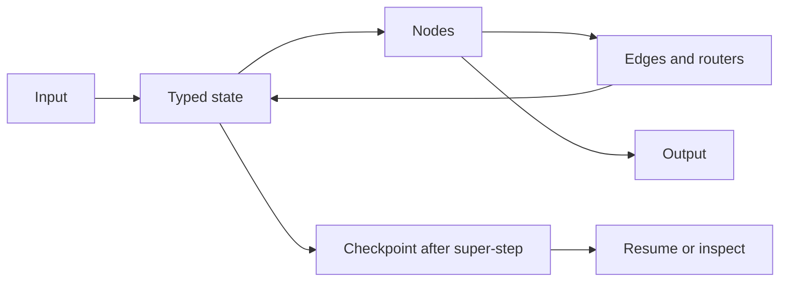
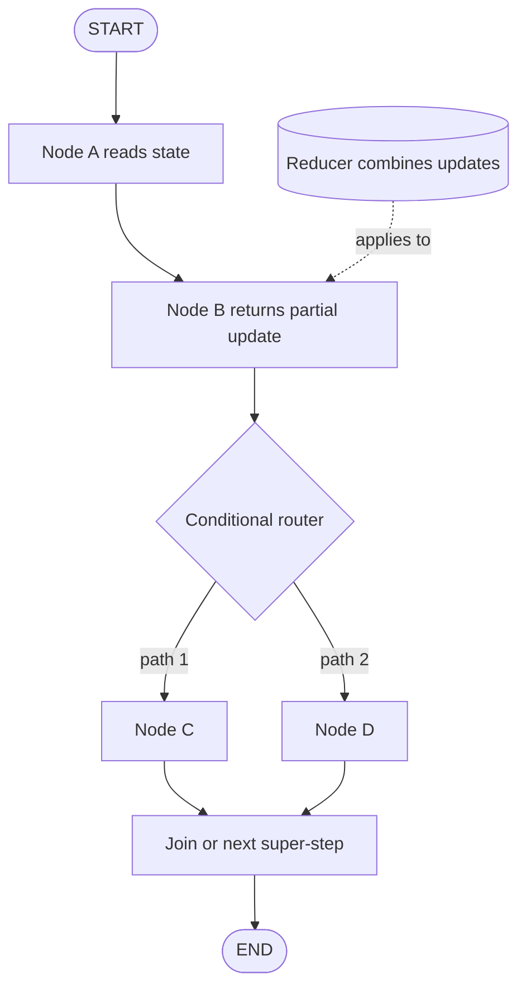
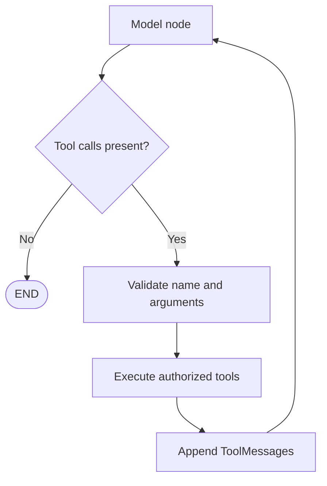
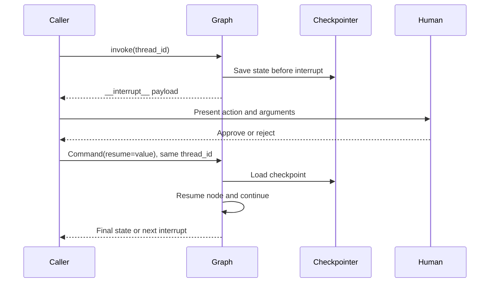
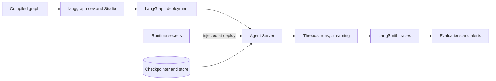

# LangGraph Python Handbook

## Document map (this file's structure)

1. [Mental model](#1-mental-model)
2. [Choosing an API](#2-choosing-an-api)
3. [State and reducers](#3-state-and-reducers)
4. [Nodes, edges, and control flow](#4-nodes-edges-and-control-flow)
5. [Tools and tool calling](#5-tools-and-tool-calling)
6. [Persistence, threads, and memory](#6-persistence-threads-and-memory)
7. [Interrupts and human-in-the-loop](#7-interrupts-and-human-in-the-loop)
8. [Streaming](#8-streaming)
9. [Subgraphs](#9-subgraphs)
10. [Fault tolerance](#10-fault-tolerance)
11. [Time travel](#11-time-travel)
12. [Workflows versus agents](#12-workflows-versus-agents)
13. [Testing](#13-testing)
14. [Studio, observability, and deployment](#14-studio-observability-and-deployment)
15. [Migration from legacy APIs](#15-migration-from-legacy-apis)
16. [Runnable mini-project](#16-complete-runnable-mini-project)
17. [Execution model and graph lifecycle](#17-execution-model-and-graph-lifecycle)
18. [State schema and channel reference](#18-state-schema-and-channel-reference)
19. [Graph API method guide](#19-graph-api-method-guide)
20. [Routing, fan-out, and coordination patterns](#20-routing-fan-out-and-coordination-patterns)
21. [Functional API field guide](#21-functional-api-field-guide)
22. [Persistence internals and store operations](#22-persistence-internals-and-store-operations)
23. [Interrupt semantics and approval design](#23-interrupt-semantics-and-approval-design)
24. [Streaming and observability field guide](#24-streaming-and-observability-field-guide)
25. [Fault handling and durable side effects](#25-fault-handling-and-durable-side-effects)
26. [Agent orchestration patterns](#26-agent-orchestration-patterns)
27. [Graph testing and debugging playbook](#27-graph-testing-and-debugging-playbook)
28. [Production operations, security, and cost](#28-production-operations-security-and-cost)
29. [Course repository topic map](#29-course-repository-topic-map)
30. [API coverage and reference policy](#30-api-coverage-and-reference-policy)

> A focused, Python-only guide to the current LangGraph runtime. Examples target the current LangGraph 1.x APIs documented at [LangGraph for Python](https://docs.langchain.com/oss/python/langgraph/overview).

## 1. Mental Model

LangGraph models an application as a stateful program made of:

- **State**: the typed data snapshot shared by nodes.
- **Nodes**: Python functions that read state and return partial updates.
- **Edges**: fixed or conditional transitions that choose the next node.

Execution proceeds in discrete **super-steps**. Parallel nodes in one super-step can update the same state; reducers determine how concurrent or successive updates combine. A graph must be compiled before invocation. See the [Graph API overview](https://docs.langchain.com/oss/python/langgraph/graph-api).

LangGraph is lower-level infrastructure. LangChain's [`create_agent`](https://docs.langchain.com/oss/python/langchain/agents) returns a compiled LangGraph graph for the common tool-calling agent loop; use custom LangGraph when you need explicit topology, durable steps, branching, approval gates, or custom state.



## 2. Choosing An API

### Graph API

Use [`StateGraph`](https://reference.langchain.com/python/langgraph/graph/state/StateGraph) when the workflow is easier to explain as a topology: explicit nodes, branches, loops, parallel fan-out, joins, and inspectable state. It also gives you graph visualization with `graph.get_graph()`.

```python
from typing_extensions import TypedDict
from langgraph.graph import END, START, StateGraph


class State(TypedDict):
    topic: str
    answer: str


def write_answer(state: State) -> dict[str, str]:
    return {"answer": f"Answer about {state['topic']}"}


builder = StateGraph(State)
builder.add_node("write_answer", write_answer)
builder.add_edge(START, "write_answer")
builder.add_edge("write_answer", END)
graph = builder.compile()

result = graph.invoke({"topic": "graphs"})
```

The shorthand `StateGraph(State).add_sequence([step_a, step_b])` is useful for linear flows. See [create a sequence](https://docs.langchain.com/oss/python/langgraph/use-graph-api#why-split-application-steps-into-a-sequence-with-langgraph).

### Functional API

Use [`@entrypoint`](https://reference.langchain.com/python/langgraph/func/entrypoint) and [`@task`](https://reference.langchain.com/python/langgraph/func/task) when ordinary Python control flow is the clearest design. `@entrypoint` defines the durable workflow; `@task` marks work that can be persisted, retried by the runtime, awaited, or run concurrently.

```python
from langgraph.func import entrypoint, task


@task
def double(value: int) -> int:
    return value * 2


@entrypoint()
def workflow(value: int) -> int:
    return double(value).result()


assert workflow.invoke(21) == 42
```

The APIs share the same runtime and can call one another. Graph API checkpoints occur after super-steps; Functional API task results are saved to the entrypoint checkpoint. Functional workflows are not statically visualized. See [Functional API](https://docs.langchain.com/oss/python/langgraph/functional-api) and [using it](https://docs.langchain.com/oss/python/langgraph/use-functional-api).

## 3. State And Reducers

The usual schema is a `TypedDict`; dataclasses are convenient for defaults, and Pydantic models are available when recursive validation matters, at some performance cost. State can have separate input/output schemas and private internal channels. See [state and schemas](https://docs.langchain.com/oss/python/langgraph/graph-api#state).

By default, a node update **overwrites** the corresponding key. A reducer receives `(current_value, node_update)` and returns the next value. Use `Annotated` to attach one:

```python
import operator
from typing import Annotated
from typing_extensions import TypedDict


class State(TypedDict):
    messages: Annotated[list[str], operator.add]
    status: str
```

`{"messages": ["new"]}` appends, while `{"status": "done"}` replaces. Reducers must be associative enough for your parallel topology; do not depend on an accidental ordering of parallel updates. The built-in [`MessagesState`](https://reference.langchain.com/python/langgraph/graph/messages/MessagesState) and [`add_messages`](https://reference.langchain.com/python/langgraph/graph/message/add_messages) are useful for message histories because they merge message IDs rather than blindly concatenating lists.

Keep state small and serializable. Put durable, cross-thread facts in a store rather than duplicating them in every checkpoint. Private channels are not automatically secret: `stream_mode="values"` can expose all channels unless you restrict `output_keys`. See [reducers](https://docs.langchain.com/oss/python/langgraph/graph-api#reducers).

## 4. Nodes, Edges, And Control Flow

### Nodes

A node can be synchronous or asynchronous and normally has the shape `node(state) -> dict`. It may also receive runtime context, a store, or return a [`Command`](https://docs.langchain.com/oss/python/langgraph/graph-api#command) for combined state update and routing.

```python
async def fetch(state: State) -> dict[str, str]:
    value = await fetch_from_service(state["topic"])
    return {"answer": value}
```

Keep side effects idempotent where possible. A node can be re-executed after a retry, resume, replay, or time-travel fork.

### Fixed edges

`START` is the virtual entry node; `END` is the virtual terminal node. A graph needs a path from `START`, and execution halts when no active nodes remain.

```python
builder.add_edge(START, "draft")
builder.add_edge("draft", "review")
builder.add_edge("review", END)
```

An edge from one source to several destinations creates parallel fan-out. A node with incoming edges from all branches acts as a synchronization point. See [edges](https://docs.langchain.com/oss/python/langgraph/graph-api#edges).

### Conditional routing

`add_conditional_edges(source, router, path_map)` calls a router with the current state. It may return one node name, `END`, or multiple destinations. Annotate the return type with `Literal` or pass a path map so the graph can be validated and visualized accurately.

```python
from typing import Literal
from langgraph.graph import END


def route(state: State) -> Literal["retry", "answer", END]:
    if state.get("status") == "retry":
        return "retry"
    if state.get("answer"):
        return "answer"
    return END


builder.add_conditional_edges(
    "check",
    route,
    {"retry": "retry", "answer": "answer", END: END},
)
```

For dynamic fan-out over items, use [`Send`](https://docs.langchain.com/oss/python/langgraph/graph-api#send) from a routing function. For state update plus immediate routing from a node, return `Command[Literal[...]]`. See [conditional branching](https://docs.langchain.com/oss/python/langgraph/use-graph-api#conditional-branching).



## 5. Tools And Tool Calling

A tool is a typed function exposed to a chat model. `bind_tools` only tells the model what it may request; your graph still executes the request and returns a `ToolMessage` (or use a ready-made tool node/agent).

```python
from langchain.chat_models import init_chat_model
from langchain.tools import tool


@tool
def add(a: int, b: int) -> int:
    """Add two integers."""
    return a + b


model = init_chat_model("provider:model", temperature=0)  # placeholder
model_with_tools = model.bind_tools([add])
response = model_with_tools.invoke("What is 2 + 3?")
print(response.tool_calls)  # The provider may return a tool request.
```

The canonical manual loop is: model node -> inspect the last `AIMessage.tool_calls` -> execute each requested tool -> append `ToolMessage`s -> loop back to the model; route to `END` when there are no tool calls. Validate tool names and arguments, enforce authorization and timeouts, and treat tool input as untrusted. See [LangChain tools](https://docs.langchain.com/oss/python/langchain/tools) and the [Python quickstart](https://docs.langchain.com/oss/python/langgraph/quickstart).

For a standard ReAct-style agent in current LangChain, prefer `from langchain.agents import create_agent`; it is built on LangGraph and supports tools, middleware, context, structured output, and checkpointers. See [agent migration](https://docs.langchain.com/oss/python/migrate/langchain-v1#migrate-to-create_agent).



## 6. Persistence, Threads, And Memory

Compile with a checkpointer to save a state snapshot at each super-step:

```python
from langgraph.checkpoint.memory import InMemorySaver

checkpointer = InMemorySaver()  # development/testing only
graph = builder.compile(checkpointer=checkpointer)
config = {"configurable": {"thread_id": "user-42-conversation-1"}}
graph.invoke({"topic": "first turn"}, config)
graph.invoke({"topic": "follow-up"}, config)  # resumes this thread
```

The `thread_id` is the durable cursor. Reusing it loads the thread; changing it starts a new one. `InMemorySaver` is process-local. Production needs a durable checkpointer integration; the [checkpointers guide](https://docs.langchain.com/oss/python/langgraph/checkpointers) lists options. Agent Server manages checkpoint infrastructure automatically.

Use `graph.get_state(config)` for the current snapshot and `graph.get_state_history(config)` for checkpoints. Checkpoints enable conversation continuity, interrupts, fault tolerance, and time travel. `update_state` creates a new checkpoint and does not rewrite history.

### Checkpointer versus store

| Concern | Checkpointer | Store |
| --- | --- | --- |
| Scope | One `thread_id` | Across threads |
| Data | Graph state snapshots | Application-defined key/value items |
| Use | Conversation memory, resume, HITL, replay | User preferences, facts, shared knowledge |
| Access | Graph config | Store namespace and key |

Use [`InMemoryStore`](https://reference.langchain.com/python/langgraph/store/memory/InMemoryStore) for development and a persistent provider such as Postgres, MongoDB, Redis, or Upstash in production. Compile with both and access the store through the injected [`Runtime`](https://reference.langchain.com/python/langgraph/runtime/Runtime):

```python
from dataclasses import dataclass
from langgraph.runtime import Runtime
from langgraph.store.memory import InMemoryStore


@dataclass
class Context:
    user_id: str


store = InMemoryStore()


def remember(state: State, runtime: Runtime[Context]) -> dict:
    namespace = (runtime.context.user_id, "memories")
    store.put(namespace, "favorite-topic", {"topic": state["topic"]})
    return {}


builder = StateGraph(State, context_schema=Context)
graph = builder.compile(checkpointer=checkpointer, store=store)
graph.invoke({"topic": "Python"}, config, context=Context(user_id="42"))
```

See [stores](https://docs.langchain.com/oss/python/langgraph/stores) and [persistence](https://docs.langchain.com/oss/python/langgraph/persistence). Do not put secrets in state or stores unless encryption, access control, retention, and redaction are designed explicitly.

## 7. Interrupts And Human-in-the-Loop

Dynamic HITL uses [`interrupt(payload)`](https://reference.langchain.com/python/langgraph/types/interrupt). It requires a checkpointer and a stable `thread_id`:

```python
from langgraph.types import interrupt


def approve(state: State) -> dict:
    decision = interrupt({"action": "approve", "draft": state["answer"]})
    return {"status": "approved" if decision else "rejected"}
```

The initial invocation returns an interrupt payload under `__interrupt__` with the default API. Resume the **same thread** with `Command(resume=value)`:

```python
from langgraph.types import Command

graph.invoke({"topic": "draft"}, config)
graph.invoke(Command(resume=True), config)
```

On resume, the node starts again from its beginning, so code before `interrupt()` must be safe to repeat. For several simultaneous interrupts, resume with a mapping from interrupt IDs to answers. An interrupt is not an ordinary exception: it bypasses retries and error handlers. See [interrupts](https://docs.langchain.com/oss/python/langgraph/interrupts).

For approval before a tool, put the interrupt immediately before the side effect or use LangChain's [`HumanInTheLoopMiddleware`](https://docs.langchain.com/oss/python/langchain/human-in-the-loop) for a standard agent.



## 8. Streaming

`graph.stream`/`graph.astream` support `values`, `updates`, `messages`, `custom`, `checkpoints`, `tasks`, and `debug` modes. Current docs recommend typed event streaming for new applications; for direct graph streams, prefer `version="v2"`:

```python
for part in graph.stream(
    {"topic": "ice cream"},
    stream_mode=["updates", "custom"],
    version="v2",
):
    if part["type"] == "updates":
        print(part["data"])
    elif part["type"] == "custom":
        print(part["data"])
```

`values` emits full state; `updates` emits node updates; `messages` emits model token chunks and metadata; `custom` emits data written through `get_stream_writer()`. `version="v2"` consistently yields `{"type", "ns", "data"}` and `ns` identifies a subgraph. Set `subgraphs=True` to include nested graph output. See [streaming](https://docs.langchain.com/oss/python/langgraph/streaming) and [event streaming](https://docs.langchain.com/oss/python/langgraph/event-streaming).

## 9. Subgraphs

Compile a child `StateGraph` and add the compiled graph as a parent node:

```python
child = StateGraph(ChildState)
child.add_node("step", child_step)
child.add_edge(START, "step")
child_graph = child.compile()

parent = StateGraph(ParentState)
parent.add_node("child", child_graph)
parent.add_edge(START, "child")
graph = parent.compile()
```

Use shared state keys when parent and child need direct data exchange. Otherwise map parent state to child state in a wrapper node. By default a child inherits the parent's checkpointer and is treated as one parent-level super-step. Compile a child with its own checkpointer when you need accumulated per-thread child state or finer-grained time travel. State access and subgraph inspection require the child to be statically discoverable; a subgraph hidden inside a tool is not statically inspectable, although interrupts still propagate. See [subgraphs](https://docs.langchain.com/oss/python/langgraph/use-subgraphs).

## 10. Fault Tolerance

Configure retries per node with [`RetryPolicy`](https://reference.langchain.com/python/langgraph/types/RetryPolicy):

```python
from langgraph.types import RetryPolicy

builder.add_node(
    "external_api",
    external_api,
    retry_policy=RetryPolicy(max_attempts=3),
)
```

Retries, timeouts, and error handlers compose in that order: each attempt runs, matching failures retry, and the error handler runs only after retries are exhausted. Current LangGraph supports async node timeouts with `timeout=` or `TimeoutPolicy`; sync nodes cannot use node timeouts directly. Use `asyncio.to_thread` for blocking I/O inside an async node. See [fault tolerance](https://docs.langchain.com/oss/python/langgraph/fault-tolerance).

Checkpointing also provides pending writes: if one parallel node fails, successful writes from that super-step need not be repeated when the run resumes. Still make external side effects idempotent and use provider-level idempotency keys.

## 11. Time Travel

Time travel has two forms:

- **Replay**: invoke using a prior checkpoint config; nodes after that checkpoint execute again.
- **Fork**: call `update_state` against a prior checkpoint, then invoke the returned config to explore a modified branch.

```python
history = list(graph.get_state_history(config))
before_review = next(snapshot for snapshot in history if snapshot.next == ("review",))

# Replay. Nodes after this checkpoint run again.
graph.invoke(None, before_review.config)

# Fork. The original history remains intact.
fork_config = graph.update_state(
    before_review.config,
    values={"answer": "alternative draft"},
)
graph.invoke(None, fork_config)
```

Replay is not a cache: LLM calls, APIs, and interrupts can produce different results. Interrupts are re-triggered during replay. See [time travel](https://docs.langchain.com/oss/python/langgraph/use-time-travel).

## 12. Workflows Versus Agents

The [workflows and agents guide](https://docs.langchain.com/oss/python/langgraph/workflows-agents) distinguishes:

- **Workflow**: predetermined code paths. Prefer fixed edges, structured outputs, validators, branches, and explicit retries when reliability and auditability matter.
- **Agent**: dynamic model-directed process and tool selection. Use a tool-calling loop or `create_agent` when the model must decide the next action.

Many useful systems are hybrids: a deterministic outer graph with an agent subgraph for one bounded research step, followed by validation and approval. Bound agent loops with a maximum iteration count, tool allowlist, budgets, and termination conditions.

## 13. Testing

Test pure nodes and routers as ordinary Python functions, then test compiled paths with a fresh checkpointer per test. The current [LangGraph testing guide](https://docs.langchain.com/oss/python/langgraph/test) recommends `pytest` and `InMemorySaver`:

```python
def test_graph_path() -> None:
    graph = make_graph().compile(checkpointer=InMemorySaver())
    result = graph.invoke(
        {"topic": "test"},
        config={"configurable": {"thread_id": "test-1"}},
    )
    assert result["answer"]
```

Use `graph.nodes["node_name"].invoke(...)` to unit-test an individual compiled node; this bypasses checkpointer behavior. For partial execution, seed a checkpoint with `update_state(..., as_node="previous_node")` and stop with `interrupt_after`. Add tests for reducers, conditional routes, retries, duplicate/resume behavior, interrupts, tool errors, and serialization boundaries. Keep model calls behind injected fakes or deterministic fixtures.

## 14. Studio, Observability, And Deployment

### Studio

[LangSmith Studio](https://docs.langchain.com/oss/python/langgraph/studio) connects to a local Agent Server, visualizes graph steps, prompts, tool calls, state, errors, and threads, and supports hot reload. Python 3.11+ is required for the current CLI setup:

```bash
pip install --upgrade "langgraph-cli[inmem]"
langgraph dev
```

The CLI reads a `langgraph.json` such as:

```json
{
  "dependencies": ["."],
  "graphs": {"agent": "./src/agent.py:graph"},
  "env": ".env"
}
```

Use placeholders in documentation and keep `.env` out of version control. Studio can be used with tracing disabled via `LANGSMITH_TRACING=false`; otherwise configure a real `LANGSMITH_API_KEY` locally, never in source.

### Observability

[LangSmith Observability](https://docs.langchain.com/langsmith/observability) records traces of graph runs, node transitions, prompts, model calls, tool arguments/results, latency, tokens, errors, and feedback. Set tracing environment variables in the runtime environment, tag runs with deployment/user/thread metadata, and redact secrets or sensitive payloads before sending traces. Use traces to build regression datasets and online/offline evaluations; dashboards and alerts catch production drift.

### Deployment

The [LangSmith Deployment](https://docs.langchain.com/langsmith/deployment) Agent Server provides durable execution, threads, assistants, runs, streaming, and horizontal scaling. A typical path is:

1. Export a compiled graph from `langgraph.json`.
2. Test locally with `langgraph dev` and Studio.
3. Build/deploy with the [LangGraph CLI](https://docs.langchain.com/langsmith/cli), for example `langgraph deploy` for supported Cloud deployments.
4. Choose Cloud, hybrid, self-hosted control plane, or standalone server according to residency and operations requirements.

Agent Server handles checkpointer/store infrastructure for its deployment environment. Provider credentials and LangSmith credentials remain deployment secrets, not code constants. Treat `langgraph deploy` as beta where the current deployment quickstart labels it so.



## 15. Migration From Legacy APIs

For LangChain v1, use the [migration guide](https://docs.langchain.com/oss/python/migrate/langchain-v1):

| Legacy | Current |
| --- | --- |
| `langgraph.prebuilt.create_react_agent` | `langchain.agents.create_agent` |
| `prompt=` | `system_prompt=` |
| `pre_model_hook`, `post_model_hook`, `state_modifier` | Agent middleware (`before_model`, `after_model`, wrappers) |
| Prompted structured output tuples | `ToolStrategy` or `ProviderStrategy` |
| Stream node name `"agent"` | `"model"` |
| Runtime dependencies only in `configurable` | `context=` plus `context_schema=` |
| Legacy chains/retrievers/indexes/hub | `langchain-classic` and `langchain_classic.*` |

Do not mechanically mix old examples with current imports. Search for `create_react_agent`, `langgraph.prebuilt`, old hooks, and legacy `langchain.chains` imports. Preserve old APIs only when a concrete compatibility constraint exists; otherwise migrate to current namespaces and test stream event names and state schemas.

## 16. Complete Runnable Mini-Project

This project is deterministic and needs no model provider or secret. It demonstrates typed state, a reducer, fixed and conditional edges, a local tool-call-shaped loop, persistence, streaming, and HITL. Replace the deterministic planner with a real `model.bind_tools(...)` call only after configuring a provider.

Install:

```bash
python -m pip install -U langgraph langchain-core
```

Save as `mini_langgraph.py` and run `python mini_langgraph.py`:

```python
from __future__ import annotations

import operator
from typing import Annotated, Literal
from typing_extensions import TypedDict

from langgraph.checkpoint.memory import InMemorySaver
from langgraph.graph import END, START, StateGraph
from langgraph.types import Command, interrupt


class State(TypedDict):
    request: str
    numbers: list[int]
    tool_calls: Annotated[list[str], operator.add]
    answer: str
    approved: bool


def parse_request(state: State) -> dict:
    # Deterministic stand-in for an LLM planner.
    numbers = [int(token) for token in state["request"].split() if token.isdigit()]
    if len(numbers) != 2:
        raise ValueError("Request must contain exactly two integers")
    return {"numbers": numbers}


def route_after_parse(state: State) -> Literal["calculate", END]:
    return "calculate" if len(state.get("numbers", [])) == 2 else END


def calculate(state: State) -> dict:
    a, b = state["numbers"]
    # This is the tool execution step. A real model would produce this request.
    return {
        "tool_calls": [f"add(a={a}, b={b})"],
        "answer": str(a + b),
    }


def approve(state: State) -> dict:
    decision = interrupt(
        {"kind": "approval", "question": f"Approve answer {state['answer']}?"}
    )
    return {"approved": bool(decision)}


def route_after_approval(state: State) -> Literal["publish", END]:
    return "publish" if state.get("approved") else END


def publish(state: State) -> dict:
    return {"answer": f"The answer is {state['answer']}"}


def build_graph():
    builder = StateGraph(State)
    builder.add_node("parse_request", parse_request)
    builder.add_node("calculate", calculate)
    builder.add_node("approve", approve)
    builder.add_node("publish", publish)
    builder.add_edge(START, "parse_request")
    builder.add_conditional_edges(
        "parse_request", route_after_parse, {"calculate": "calculate", END: END}
    )
    builder.add_edge("calculate", "approve")
    builder.add_conditional_edges(
        "approve", route_after_approval, {"publish": "publish", END: END}
    )
    builder.add_edge("publish", END)
    return builder.compile(checkpointer=InMemorySaver())


if __name__ == "__main__":
    graph = build_graph()
    config = {"configurable": {"thread_id": "demo-thread"}}
    initial = {"request": "Add 20 and 22", "tool_calls": []}

    print("Streaming updates:")
    for part in graph.stream(initial, config, stream_mode="updates", version="v2"):
        print(part["data"])

    # The run pauses at approve. Resume the same thread with human approval.
    resumed = graph.invoke(Command(resume=True), config)
    print("Final:", resumed["answer"])
```

Expected final output includes `The answer is 42`. The example uses `InMemorySaver` intentionally so it is self-contained; replace it with a durable integration before using threads or interrupts in production. A real tool-calling planner would use the model/tool pattern in [Tools And Tool Calling](#5-tools-and-tool-calling), and a real deployment would export `graph` through `langgraph.json` as described in [Deployment](#deployment).

## Practical Checklist

- Define the smallest state that makes the workflow deterministic and inspectable.
- Use reducers intentionally, especially for parallel writes and message history.
- Make retries, timeouts, tool permissions, and loop termination explicit.
- Compile with a checkpointer for threads, HITL, recovery, or time travel.
- Use a store for cross-thread memory, not the checkpointer as a global database.
- Treat replay and resume as re-execution; make side effects idempotent.
- Test routers, reducers, node failures, interrupts, and tool errors without real providers.
- Stream only the state and channels the caller is allowed to see.
- Trace with LangSmith after redaction and deploy with secrets supplied by the runtime.
- Check the current official docs before pinning versions or copying provider-specific examples.

## Caveats

- LangGraph and LangChain APIs evolve quickly; verify package versions against the current [Python reference](https://reference.langchain.com/python/langgraph/) and the linked docs.
- Some features in this handbook, notably node timeouts and typed event-stream projections, have minimum-version requirements stated in their source guides.
- `InMemorySaver` and `InMemoryStore` are for local development/testing, not durable production persistence.
- The mini-project intentionally uses no real LLM or secrets, so its planner is deterministic rather than probabilistic model tool calling.

## 17. Execution model and graph lifecycle

### From builder to executable

`StateGraph` is a builder, not the running workflow. Its lifecycle is:

1. Define the state channels and the input/output contract.
2. Register named node actions and optional node policies.
3. Connect the virtual `START` node, ordinary nodes, routers, and `END`.
4. Compile the builder, optionally injecting checkpointer/store and graph-wide configuration.
5. Invoke, stream, inspect state, and resume through the compiled graph.

```python
from typing_extensions import TypedDict
from langgraph.graph import END, START, StateGraph

class State(TypedDict):
    request: str
    normalized: str

def normalize(state: State) -> dict[str, str]:
    return {"normalized": state["request"].strip().casefold()}

builder = StateGraph(State)
builder.add_node("normalize", normalize)
builder.add_edge(START, "normalize")
builder.add_edge("normalize", END)
app = builder.compile()
result = app.invoke({"request": "  LANGGRAPH  "})
```

Compilation performs graph construction/validation and returns an executable Pregel-backed application. It does not call the model or run a node. The executable graph supports the runnable execution surface; exact options are versioned in the [Graph API reference](https://reference.langchain.com/python/langgraph/).

### Pregel and super-steps

LangGraph runs active nodes in super-steps. Nodes scheduled in the same super-step read the state snapshot for that step, execute independently (and can execute concurrently), and emit channel writes. Channel/reducer logic applies writes to produce the next state. The graph then schedules the next active tasks according to edges and routing results. This means:

- A node should return a partial update mapping, not mutate a shared state object.
- A node in one parallel branch should not expect to read another branch’s uncommitted write from the same super-step.
- Parallel writes to a last-value channel can be invalid or nondeterministic; accumulated channels need a reducer designed for concurrent updates.
- A downstream join should run only after the intended upstream tasks have completed.
- Checkpoint boundaries and pending writes matter when a node fails during a super-step.

The [Pregel overview](https://docs.langchain.com/oss/python/langgraph/pregel) explains the execution engine beneath both the Graph API and Functional API. Use the state-machine mental model when debugging; a graph is not simply a list of Python function calls.

### Lifecycle and invocation surface

| Method / property | Intended use | Important detail |
| --- | --- | --- |
| `compile(...)` on builder | Freeze topology into an executable graph | Inject checkpointer/store and supported compile policies here. |
| `invoke(input, config=None, **kwargs)` | Run until a stopping boundary and obtain a result | A checkpointed run uses `thread_id`; `None` input can resume from a saved checkpoint in time-travel workflows. |
| `ainvoke(...)` | Async invocation | Use async node/provider methods to avoid blocking the event loop. |
| `stream(input, config=None, *, stream_mode=..., version=...)` | Consume incremental graph output | Choose modes deliberately; `values` may disclose complete state. |
| `astream(...)` | Async streaming | Propagate disconnect/cancellation and close consumers cleanly. |
| `batch(...)` / `abatch(...)` | Invoke multiple independent inputs | Apply bounded concurrency and isolate thread IDs when persistent executions are independent. |
| `get_graph(...)` | Inspect or visualize graph topology | Useful for Mermaid/DOT diagrams and structural debugging; generated drawing support can have optional dependencies. |
| `get_state(config)` | Read latest checkpoint snapshot | Requires a checkpointer and a valid thread configuration. |
| `get_state_history(config, ...)` | Iterate thread snapshots | History order and filtering parameters are documented on the current API page. |
| `update_state(config, values, as_node=...)` | Create a new checkpoint derived from state | Values pass through reducers unless wrapped with `Overwrite`; this does not rewrite old history. |
| `get_subgraphs(...)` / subgraph state inspection | Inspect discoverable nested graphs | Runtime-created/hidden graph structures may not be statically introspectable. |

The public `CompiledStateGraph` and Pregel APIs include more options than this table. Link exact callable signatures to the [Python API reference](https://reference.langchain.com/python/langgraph/) rather than freezing an incomplete signature in prose.

## 18. State schema and channel reference

### State is a channel schema

State is not just a mutable dictionary. Each key corresponds to a channel with a value type and update rule. A node returns a mapping of channel updates. Channels omitted from the return remain unchanged.

Supported schema approaches include `TypedDict`, dataclasses, and Pydantic models. Choose based on validation and ergonomics; understand the runtime costs and defaults of the selected form. State can have separate input/output schemas and private/internal channels when the graph needs to distinguish public requests/results from intermediate values.

| Schema choice | Strength | Constraint |
| --- | --- | --- |
| `TypedDict` | Lightweight annotations and explicit channel names | Type hints are not runtime validation by themselves. |
| `dataclass` | Python defaults and familiar field declaration | Validate serialization and the installed runtime’s dataclass support. |
| Pydantic model | Runtime validation and richer field constraints | Additional validation cost; avoid over-validating every super-step for very large state. |
| Separate input/output schema | Hide private work channels from the external contract | Be explicit about which nodes can write which channels and what the compiled graph returns. |

### Reducers

Without an explicit reducer, the standard last-value channel expects a single update per step and replaces the prior value. `Annotated[type, reducer]` attaches a binary reducer for sequential/parallel updates. The function should accept `(current_value, update)` and return the accumulated value.

```python
import operator
from typing import Annotated
from typing_extensions import TypedDict

class WorkState(TypedDict):
    status: str
    notes: Annotated[list[str], operator.add]
    total: Annotated[int, operator.add]
```

Reducer design checklist:

- The accumulator and update types must agree.
- The operation should be associative for parallel reductions; avoid relying on branch completion order.
- Decide whether duplicates are valid. List concatenation preserves duplicate writes; it does not deduplicate.
- For set-like aggregation, define deterministic ordering before producing user-facing output.
- `update_state` applies the channel reducer too. Use `Overwrite(value)` when you explicitly need to replace the channel rather than reduce the update.
- A reducer is not an authorization mechanism and does not make a shared global mutable object safe.

### Message state and `add_messages`

`MessagesState` is the convenience schema for chat histories. The `add_messages` reducer appends new messages while merging updates with matching message IDs; it is more appropriate than `operator.add` when messages can be edited or removed. Message identifiers matter for deduplication and update behavior. A custom schema can use the same reducer on its own `messages` channel.

Use `RemoveMessage` only with a compatible message-aware reducer. Do not trim away an assistant tool call while retaining its tool result, or vice versa; model/provider protocol constraints still apply after checkpoint reload.

### Runtime context is different from state

Use graph state for data that belongs to the workflow and may need checkpointing. Use `context_schema`/`context=` for trusted per-invocation dependencies such as authenticated principal, tenant, request timestamp, or service handles. Nodes can receive `Runtime[Context]` to access context, store, and supported runtime capabilities. Do not let a user prompt set a trusted identity field. Context should be serializable or have lifecycle behavior compatible with the deployment mode when its value must cross process boundaries.

Use `RunnableConfig` for execution configuration such as thread/run IDs, tags, metadata, configurable values, and recursion limits. Keep these concepts distinct: state is workflow data, runtime context is application-provided dependencies, config is execution controls/tracing metadata, and store/checkpointer are persistence services.

## 19. Graph API method guide

### Builder methods

| API | Purpose | Common mistakes |
| --- | --- | --- |
| `StateGraph(state_schema, context_schema=None, input_schema=None, output_schema=None)` | Define a graph builder and channel schemas | Treating a schema annotation as a guarantee of runtime validation; putting secrets in state. |
| `add_node(name, action, **options)` | Register a node action | Duplicate/unstable names, incompatible node input schema, or retry options on the wrong library release. |
| `add_sequence([...])` | Register a series of steps when topology is linear | Using it where conditional control flow or explicit state transforms are needed. |
| `add_edge(start, end)` | Define a fixed transition; multiple sources can synchronize at a downstream node | Assuming a conditional route is also present or that a join waits for sources not listed. |
| `add_conditional_edges(source, path, path_map=None)` | Route using current state or dispatch multiple next nodes | Returning a name not registered in the graph; omitting route type/path map and losing useful graph validation/visualization. |
| `set_entry_point(name)` / `set_finish_point(name)` | Legacy convenience for `START`/`END` edges | Prefer explicit `START` and `END` in new examples so control flow is visible. |
| `compile(...)` | Validate/prepare the runnable graph | Invoking the builder before compilation, or compiling before all intended nodes/edges are registered. |

`add_node` accepts advanced policies such as retry, cache, timeout, error-handler, defer, metadata, and input-schema options in supported releases. Their exact keyword names and interaction order have changed over time. Use the linked [`StateGraph` class reference](https://reference.langchain.com/python/langgraph/graph/state/StateGraph) and the [fault tolerance guide](https://docs.langchain.com/oss/python/langgraph/fault-tolerance) for exact installed-version details.

### Routing types

- `START` and `END` are special boundary values, not user-created node names.
- A fixed edge always schedules its destination after the source is complete.
- A conditional edge calls a router against the current state and can return one route or several routes.
- A path map translates router labels into registered node names and documents the allowed outcomes.
- `Send(node, arg)` creates a task for a node with a per-task input. It enables dynamic map/fan-out and does not require each worker to receive identical parent state.
- `Command(update=..., goto=...)` combines channel updates and dynamic routing from a node. Add a `Command[Literal[...]]` return annotation where practical so valid destinations are discoverable.
- `Command.PARENT` can route from a subgraph to a parent graph when that pattern is supported and deliberately configured.

An important control-flow rule: `Command(goto="x")` introduces dynamic routing; it does not cancel static edges already declared from that node. If both are attached, both transitions can execute. Choose one routing mechanism for a given decision unless multiple destinations are intended.

## 20. Routing, fan-out, and coordination patterns

### Conditional routes and loops

Use a conditional edge for a branch after a node, such as `retrieve -> answer` or `retrieve -> rewrite -> retrieve`. Make loop progress explicit in state: iteration count, current query, candidate set, and stop reason. Define every exit path, including empty input, failed validation, no relevant evidence, and exhausted retries.

```python
from typing import Literal
from langgraph.graph import END

def after_review(state: dict) -> Literal["revise", "publish", END]:
    if state.get("attempts", 0) >= 3:
        return END
    if state.get("approved"):
        return "publish"
    return "revise"
```

The route function should be deterministic and cheap. If an LLM must decide, make that call in a named model node, validate its result, then route from the validated state. This separates unreliable generation from control flow and makes route decisions testable.

### Dynamic map/reduce with `Send`

Use `Send` when the number or input of workers depends on runtime data. The worker can have a smaller input schema than the parent. Aggregate worker results through a reducer, then run a synthesis/join node.

```python
import operator
from typing import Annotated
from typing_extensions import TypedDict
from langgraph.graph import END, START, StateGraph
from langgraph.types import Send

class ResearchState(TypedDict):
    questions: list[str]
    findings: Annotated[list[str], operator.add]
    summary: str

class WorkerState(TypedDict):
    question: str

def dispatch(state: ResearchState) -> list[Send]:
    return [Send("worker", {"question": q}) for q in state["questions"]]

def worker(state: WorkerState) -> dict:
    return {"findings": [f"Finding for: {state['question']}"]}

def summarize(state: ResearchState) -> dict:
    return {"summary": "\n".join(state["findings"])}

builder = StateGraph(ResearchState)
builder.add_node("worker", worker)
builder.add_node("summarize", summarize)
builder.add_conditional_edges(START, dispatch, ["worker"])
builder.add_edge("worker", "summarize")
builder.add_edge("summarize", END)
app = builder.compile()
```

Bound dynamic fan-out: the caller controls input cardinality, so validate maximum tasks before building the `Send` list. Handle partial failures, empty lists, and ordering. If order matters, include an index in each worker result and sort before synthesis. Parallel result arrival order is not a contract.

### Joins and shared channels

A join should wait for all prerequisite branches that form its input. Use an edge with the required source set for an explicit barrier when that is the desired graph topology. Ensure every parallel node writes to independent channels or to reducers designed for the writes. Keep branch outputs attributable (source ID, worker ID, task key) so failures and duplicate responses can be diagnosed.

### Choosing communication patterns

- **Shared typed state**: deterministic workflows where nodes exchange well-defined fields.
- **Message history**: conversational work where tool/model messages and dialogue order matter.
- **Message passing**: agents exchange explicit work requests/results and need an auditable event trail.
- **Blackboard/shared workspace**: iterative collaborative synthesis where several roles contribute artifacts; use versioning/ownership so shared data does not become ambiguous.
- **Handoff**: transfer control to a specialist while preserving a clear return/termination contract.
- **Supervisor/router**: select specialists using validated decisions; ensure a max turn count and an escalation/fallback path.

These are different coordination contracts, not merely prompt styles. The course communication patterns in [`agent_communication.py`](https://github.com/pdichone/production-course-main-code/blob/9933fe78aba0cba40812856d9baeb0640cad70ca/agent_communication.py) contrast messages, typed shared fields, and a blackboard. Build a single-agent baseline first; add agents only when specialization, isolation, parallelism, or ownership justifies the added calls and state surface.

## 21. Functional API field guide

The Functional API uses ordinary Python control flow while marking durable work. It is useful when a workflow reads more naturally as a function than as a node diagram. It shares the LangGraph runtime, checkpointing, streaming, and interrupt model, but does not expose the same static topology for visualization.

### `@entrypoint`

`@entrypoint(...)` marks the top-level durable workflow. It accepts a function with an input and a return value; supported options configure the entrypoint name, checkpointer and other runtime behavior. Invoke it through its runnable interface (`invoke`, `ainvoke`, `stream`, and async counterparts as supported).

### `@task`

`@task` marks an operation whose completed result can be persisted and reused during resume. It supports task-level durable execution options such as retry/timeout according to the installed release. In synchronous workflows, task results are obtained through the task handle’s documented blocking/result operation; in asynchronous workflows, await the task handle. Parallel work can be expressed with `asyncio.gather` over task handles where the task API supports it.

```python
from langgraph.func import entrypoint, task

@task
def normalize(value: str) -> str:
    return value.strip().casefold()

@entrypoint()
def workflow(value: str) -> str:
    return normalize(value).result()

assert workflow.invoke("  LangGraph  ") == "langgraph"
```

### Serialization and determinism

Checkpointed entrypoint inputs/outputs and task outputs need to be serializable by the configured checkpointer. Use stable, JSON-friendly values unless an explicitly supported serializer says otherwise. Avoid hidden dependence on process-local globals, random results, wall-clock order, or mutable external state that cannot be reproduced.

During resume, completed task results can be restored rather than recomputed. Therefore task call identity/order must remain consistent across re-execution. Reordering task calls or changing the control path around an interrupt can associate restored values incorrectly. Keep non-deterministic or externally visible actions inside durable tasks and give side effects idempotency keys.

### Choosing between the APIs

Use the Graph API when named nodes, route inspection, visualization, graph-level joins, parallel state channels, or node-specific policies are central. Use the Functional API when normal Python control flow is clearer and durable task boundaries are sufficient. Do not choose based on the assumption that one API is “more durable”: both use the same runtime, but checkpoint boundaries and code constraints differ.

References: [Functional API overview](https://docs.langchain.com/oss/python/langgraph/functional-api), [`entrypoint`](https://reference.langchain.com/python/langgraph/func/entrypoint), and [`task`](https://reference.langchain.com/python/langgraph/func/task).

## 22. Persistence internals and store operations

### Checkpoint structure

A checkpoint records a point in a thread’s execution, including state values, the next scheduled work, metadata, and configuration/parent lineage. Exact fields are represented by checkpoint snapshot types in the API reference. Checkpoints enable:

- Multi-turn state on a stable thread.
- Resume after interrupts or process failure.
- State inspection and history.
- Replay/fork for debugging.
- Pending-write recovery for nodes that completed before another parallel task failed.

A checkpointer is not automatically a safe backup, a business database, or a cross-thread memory store. Define retention, privacy, encryption, workspace tenancy, migration, and deletion policies for the chosen saver.

### Saver selection and lifecycle

| Saver family | Best fit | Operational notes |
| --- | --- | --- |
| `InMemorySaver` | Tests and single-process experiments | Lost at process exit; not shared across workers. |
| SQLite checkpointer integration | Local development and lightweight local persistence | File locking, single-host use, backups, and concurrent access need consideration. |
| Postgres checkpointer integration | Durable multi-process service | Provision/setup tables through the integration’s supported workflow; manage pools, migrations, backups, and tenant policy. |
| Other integrations | Match an existing data platform or deployment service | Validate feature parity, consistency, serialization, and maintenance support. |

Saver packages are separate from `langgraph`; install the selected integration explicitly. Check current version compatibility in the [checkpointer catalog](https://docs.langchain.com/oss/python/integrations/checkpointers). Use the context-manager/lifecycle pattern required by the integration and do not repeatedly set up schema on every request.

### Thread identity and checkpointer config

`thread_id` is the checkpoint namespace key. Reuse it only when continuing the same authorized conversation. It must be supplied through `configurable` when the graph uses thread persistence. Add `checkpoint_id` or namespace fields only when the documented operation specifically requires selecting a historical checkpoint or subgraph namespace.

```python
config = {"configurable": {"thread_id": "server-issued-session-id"}}
first = graph.invoke({"messages": [{"role": "user", "content": "Remember that I prefer short answers."}]}, config)
follow_up = graph.invoke({"messages": [{"role": "user", "content": "What style do I prefer?"}]}, config)
```

Do not derive thread IDs directly from unauthenticated input. Do not reuse one thread across principals. A different thread starts a distinct checkpoint history even if the user identity is the same.

### Store API and namespaces

A Store holds application-defined key/value data across thread boundaries. Common operations include:

- `put(namespace, key, value)`: write or replace an item.
- `get(namespace, key)`: read an item or `None` when absent.
- `search(namespace_prefix, query=..., filter=..., limit=...)`: retrieve matching namespace items where the backend supports search/indexing.
- `delete(namespace, key)`: delete the item.
- Async forms such as `aput`, `aget`, `asearch`, and `adelete` when exposed by the selected store.

Namespace is typically a tuple of strings that scopes related data, for example `(tenant_id, user_id, "preferences")`. Construct it from authenticated runtime context, not model-generated fields. Store backends can vary in indexing and semantic search behavior; test query semantics, isolation, overwrite/delete behavior, and serialization on the actual backend.

### Subgraph persistence modes

For a child graph compiled and called by a parent, current LangGraph supports distinct scoping behavior documented by the [`use subgraphs` guide](https://docs.langchain.com/oss/python/langgraph/use-subgraphs):

- **Per-invocation/default inheritance**: fresh child state per call while parent persistence supports durability and interrupts within that call.
- **Per-thread**: retain child state between calls on the same thread when a specialist needs its own continuing memory.
- **Stateless/no checkpoint**: treat the child like a regular computation without checkpoint/interrupt behavior.

Use per-thread persistence only when the child truly needs to remember between invocations. Stateful subgraphs invoked more than once in a single parent step require careful namespace design; test parallel and repeated calls for conflicts. Parent checkpointer configuration is important for child interrupt/state-inspection behavior.

## 23. Interrupt semantics and approval design

### Dynamic interrupt protocol

`interrupt(payload)` saves a pause point and surfaces the payload through the run result/event. It requires a checkpointer and a stable thread ID. Resume the same thread using `Command(resume=value)`; that value becomes the return value of the suspended `interrupt()` call.

```python
from langgraph.checkpoint.memory import InMemorySaver
from langgraph.graph import END, START, StateGraph
from langgraph.types import Command, interrupt
from typing_extensions import TypedDict

class ApprovalState(TypedDict):
    operation: str
    approved: bool

def approval(state: ApprovalState) -> dict:
    decision = interrupt({"operation": state["operation"], "action": "approve or reject"})
    return {"approved": bool(decision)}

builder = StateGraph(ApprovalState)
builder.add_node("approval", approval)
builder.add_edge(START, "approval")
builder.add_edge("approval", END)
graph = builder.compile(checkpointer=InMemorySaver())
config = {"configurable": {"thread_id": "approval-001"}}

paused = graph.invoke({"operation": "publish report", "approved": False}, config)
assert paused["__interrupt__"]
finished = graph.invoke(Command(resume=True), config)
```

### Resume restarts the node

On resume, the node containing the interrupt begins again from the top; code before the interrupt runs again. This includes parent nodes that call an interrupted subgraph. Therefore:

- Put the interrupt before the external side effect when feasible.
- Use idempotent writes/upserts before an interrupt.
- Use idempotency keys for any external mutation.
- Make the approval payload contain the exact operation and arguments to be reviewed.
- Validate the resumed value as untrusted input; it might be malformed or stale.
- Re-authorize immediately before execution, since permissions can change while paused.

Several concurrent interrupts can be resumed by mapping interrupt IDs to decision values. Validate and persist each decision in an auditable application workflow. An interrupt is control flow, not an ordinary exception; normal retry/error handlers do not treat it like a transient network failure.

### Static breakpoints vs dynamic interrupts

Compile-time `interrupt_before`/`interrupt_after` breakpoints are useful for debugging or fixed inspection boundaries. `interrupt(payload)` is application-level dynamic suspension, suitable for asking for missing data or approval. Do not confuse a developer breakpoint with a production approval protocol.

### Approval design

An approval UX should display:

1. Authenticated actor and tenant.
2. Exact tool/action name and normalized parameters.
3. Target resource, current version, and expected side effect.
4. Relevant evidence and policy reason.
5. Expiration/staleness and the option to reject or edit when supported.

Approval is bound to the exact operation/version reviewed. If the resource changes while paused, reject or revalidate instead of applying a stale approval. Keep a human identity, timestamp, decision, and operation digest in the business audit log.

References: [interrupt guide](https://docs.langchain.com/oss/python/langgraph/interrupts), [`interrupt`](https://reference.langchain.com/python/langgraph/types/interrupt), and [`Command`](https://reference.langchain.com/python/langgraph/types/Command).

## 24. Streaming and observability field guide

### Stream modes

| Mode | Event content | Appropriate consumer |
| --- | --- | --- |
| `values` | Full state snapshot after an update | Trusted debugger or controlled state inspector; can disclose private channels. |
| `updates` | Partial update grouped by node/task | Progress UI, audit view, test assertions. |
| `messages` | Model message/token chunks with metadata | Token UI; aggregate chunks before interpreting full tool calls. |
| `custom` | User-defined payloads written by a stream writer | Progress percentages, stage names, safe application events. |
| `checkpoints` | Checkpoint events | Persistence-aware clients and diagnostics. |
| `tasks` | Task lifecycle information | Execution monitors. |
| `debug` | Rich diagnostic stream | Local troubleshooting; may reveal internal state. |

Names and payload projections are versioned. `version="v2"` yields a typed event envelope such as `{"type": ..., "ns": ..., "data": ...}` in current Python releases. It makes heterogeneous modes easier to consume, but the consumer must still handle each `type`. Set `subgraphs=True` when nested events are needed; preserve `ns` to attribute them to the child graph.

### Event loop and chunk aggregation

Model token chunks can split text or tool-call JSON arbitrarily. Do not parse each token as a complete tool call. If the UI needs completed tool calls, aggregate chunks or use completed state/update/custom events. Handle parallel model streams, final chunk indicators, errors, cancellations, and disconnects.

```python
for event in graph.stream(
    {"messages": [{"role": "user", "content": "Summarize this request."}]},
    stream_mode=["updates", "custom"],
    version="v2",
):
    if event["type"] == "updates":
        print("node update:", event["data"])
    elif event["type"] == "custom":
        print("application progress:", event["data"])
```

Use `get_stream_writer()` within a node to emit custom events in supported contexts. Keep event payloads small, structured, and safe for the consumer; never stream hidden chain-of-thought, secrets, or private state merely because `debug`/`values` is available.

### Trace relationship

LangGraph represents one graph invocation and its node/model/tool work in LangSmith traces when tracing is configured. Use tags and safe metadata for environment, release, request type, and source version; use `thread_id`/thread metadata for conversation linkage as supported. A trace is not a full business audit log and should not be the sole location for irreversible-action records.

See [LangGraph streaming](https://docs.langchain.com/oss/python/langgraph/streaming), [event streaming](https://docs.langchain.com/oss/python/langgraph/event-streaming), and [trace with LangGraph](https://docs.langchain.com/langsmith/trace-with-langgraph). The LangSmith handbook in [`../LangSmith/LangSmith.md`](../LangSmith/LangSmith.md) covers trace policy, datasets, evaluations, and operations.

## 25. Fault handling and durable side effects

### Failure taxonomy

| Failure | Recommended response | Avoid |
| --- | --- | --- |
| Transient transport, timeout, rate limit | Bounded retry/backoff for idempotent work; honor provider retry guidance | Infinite retries or retrying authentication/validation failures. |
| Provider/model outage | Explicit compatible fallback or a clear error path | Silent output degradation with no trace marker. |
| Invalid model/tool arguments | Validate; return a safe, structured, retryable tool result only if a model correction is useful | Executing malformed inputs or exposing stack traces to the model. |
| Missing user information/approval | Interrupt and resume same thread | Guessing a consequential choice or treating a new thread as a resume. |
| Business-rule denial | Stop/route to safe response and audit | Asking the model to override policy. |
| Programmer bug/data invariant failure | Surface the error, alert, and preserve diagnosis | Catch-all success responses or loss of traceback. |

### Retry policy and timeout

`RetryPolicy` attaches retry behavior to a node. Current docs define knobs such as `max_attempts`, `initial_interval`, backoff/multiplier, and exception matching; consult the installed API for the precise fields. A retry re-executes the node from its start. For async node timeout support, recent versions expose node timeout/policy options; sync node timeouts are not generally interruptible in the same way. Put network timeouts in the client too.

Ordering, exception matching, and interaction among node retry, timeout, and error-handler features are release-dependent. Test the actual failure that matters: rate limit, timeout, malformed response, and exhausted retry. Do not infer production retry behavior from a successful graph path.

### Durable side-effect pattern

Checkpointing records graph progress, but cannot atomically commit a remote payment/email/database write and a LangGraph checkpoint unless both participate in a transaction protocol. A crash can occur after the external system acts but before the graph records completion. Use idempotency keys, an outbox/work queue, operation state reconciliation, and explicit pending/complete transitions. Keep the model out of the transaction authority.

The course [`error_handling.py`](https://github.com/pdichone/production-course-main-code/blob/9933fe78aba0cba40812856d9baeb0640cad70ca/error_handling.py) includes custom retry, circuit-breaker and fallback sketches plus a graph agent example. These show patterns; validate current LangGraph `RetryPolicy`/timeout/error-handler APIs before adopting the custom code.

## 26. Agent orchestration patterns

### Graph vs agent harness

LangChain’s `create_agent` is the current high-level model-directed tool loop and is built on LangGraph. Use an explicit LangGraph graph when deterministic topology, specialized state transitions, graph-level parallelism, custom persistence boundaries, or controlled approval paths are core requirements. A hybrid can put one bounded agent inside an explicit workflow with deterministic validation before/after it.

### Patterns represented in the course examples

| Pattern | Control contract | Course source |
| --- | --- | --- |
| Single tool loop | Model requests a tool; tool executes; model resumes until final/no call | [`tool_calling_agent.py`](https://github.com/pdichone/production-course-main-code/blob/9933fe78aba0cba40812856d9baeb0640cad70ca/tool_calling_agent.py) |
| Conditional branch/cycle | Router selects a node; state tracks attempts and termination | [`conditional_edges.py`](https://github.com/pdichone/production-course-main-code/blob/9933fe78aba0cba40812856d9baeb0640cad70ca/conditional_edges.py), [`cycles_loops.py`](https://github.com/pdichone/production-course-main-code/blob/9933fe78aba0cba40812856d9baeb0640cad70ca/cycles_loops.py) |
| Human-reviewed action | Pause with an operation payload, then resume and validate decision | [`human_in_loop.py`](https://github.com/pdichone/production-course-main-code/blob/9933fe78aba0cba40812856d9baeb0640cad70ca/human_in_loop.py) |
| Handoff | Transfer control to a specialist using explicit route/result semantics | [`agent_handoffs.py`](https://github.com/pdichone/production-course-main-code/blob/9933fe78aba0cba40812856d9baeb0640cad70ca/agent_handoffs.py) |
| Parallel analysis / map-reduce | Fan out independent tasks, collect with reducers, synthesize after join | [`parallel_agents.py`](https://github.com/pdichone/production-course-main-code/blob/9933fe78aba0cba40812856d9baeb0640cad70ca/parallel_agents.py) |
| Supervisor | Structured/validated dispatch to researcher, writer, critic, or finalizer | [`supervisor_agent.py`](https://github.com/pdichone/production-course-main-code/blob/9933fe78aba0cba40812856d9baeb0640cad70ca/supervisor_agent.py), [`multi-agent.py`](https://github.com/pdichone/production-course-main-code/blob/9933fe78aba0cba40812856d9baeb0640cad70ca/multi-agent.py) |
| Hierarchical teams | Nested department graphs coordinated by a top-level supervisor | [`hierarchical_agents.py`](https://github.com/pdichone/production-course-main-code/blob/9933fe78aba0cba40812856d9baeb0640cad70ca/hierarchical_agents.py) |
| Research orchestration | Plan searches, dispatch with `Send`, aggregate findings, synthesize response | [`multi_agent_research_system.py`](https://github.com/pdichone/production-course-main-code/blob/9933fe78aba0cba40812856d9baeb0640cad70ca/multi_agent_research_system.py), [`research_assistant.py`](https://github.com/pdichone/production-course-main-code/blob/9933fe78aba0cba40812856d9baeb0640cad70ca/research_assistant.py) |

Each pattern should define: inputs, state owner, output schema, termination, per-agent tool permissions, retry budget, max turns, maximum parallel tasks, failure aggregation, trace attribution, and who is accountable for final validation. Passing a complete conversation to every specialist increases cost and context leakage; passing too little may remove critical provenance. Return compact, structured intermediate results with source references.

## 27. Graph testing and debugging playbook

### Unit-test graph pieces

Routers and deterministic nodes are ordinary functions; test them with representative state dictionaries and assert exact partial updates and route labels. Test reducers with multiple updates and input ordering permutations. Check invalid schemas and terminal cases.

### Test the compiled graph

Use a fresh `InMemorySaver` per test and a unique `thread_id`. Assert final public outputs and important intermediate paths. To test an individual compiled node, `graph.nodes["name"].invoke(...)` can isolate its runnable behavior but does not reproduce checkpointer/thread semantics.

Cases worth including:

- Every conditional route, including `END` and missing/unknown labels.
- Parallel branch updates, reducer behavior, synchronization, empty fan-out, and ordering independence.
- Checkpoint load after a second invocation on the same thread and isolation across different thread IDs.
- Interrupt payload shape, same-thread resume, invalid human input, reject path, and repeated-resume idempotency.
- Retry count, timeout behavior, transient vs non-transient exception, and exhausted failures.
- `update_state` through reducers and replacement via `Overwrite`.
- Serialization of state, task output, context, and subgraph values.
- Tool authorization, error normalization, side-effect idempotency, cancellation, and call-limit termination.

Use fake models/tools or deterministic fixtures for ordinary tests. Keep provider integration tests separately marked and run them only with CI secrets and spend bounds. Add a LangSmith evaluation for model-dependent quality; tests and evaluation scores answer different questions.

### Reproduce by execution layer

1. Draw the compiled topology with `get_graph()` and check node/edge names.
2. Invoke with a minimal state and `stream_mode="updates"` to locate the last successful node.
3. Inspect `get_state(config)` and checkpoint history if persistence is involved.
4. Check the `next` tasks and route output; verify whether an edge, conditional route, or `Command` caused the next node.
5. Inspect one node’s input and returned partial mapping.
6. Review reducer writes if parallel branches combine unexpectedly.
7. Use LangSmith trace detail for nested model/tool calls after applying appropriate redaction.

The course [`testing_patterns.py`](https://github.com/pdichone/production-course-main-code/blob/9933fe78aba0cba40812856d9baeb0640cad70ca/testing_patterns.py) focuses mainly on LangChain/LLM testing and evaluation; `checkpointing.py` also demonstrates state inspection and branch exploration. The current graph-specific test recipes are in [LangGraph testing docs](https://docs.langchain.com/oss/python/langgraph/test).

## 28. Production operations, security, and cost

### Deployment boundaries

The local compiled graph is the application logic. LangGraph CLI/Agent Server provides a serving runtime around exported graphs; LangSmith deployment products add managed/hybrid/self-hosted deployment capabilities according to current product availability. A Python script that calls `graph.invoke` is not equivalent to a deployment server with authenticated threads, streaming, scaling, and managed persistence.

Typical development files include:

```text
project/
  src/app/graph.py       # module exports a compiled graph
  langgraph.json         # graph/dependency/env configuration
  pyproject.toml         # pinned runtime dependencies
  .env.example           # placeholder variable names only
```

Keep `.env` out of version control. Supply credentials in the deployment’s secret configuration, choose a durable checkpointer/store, set auth and CORS/network boundaries, and test a production-like persistence backend. CLI commands and deployment targets change; consult the [LangGraph CLI guide](https://docs.langchain.com/langsmith/cli) and current [deployment guide](https://docs.langchain.com/langsmith/deployment).

### Security checklist

- Authenticate requests before selecting a thread; authorize each action in the tool/service.
- Use distinct, non-guessable thread identifiers scoped to an authenticated principal.
- Treat state, store, checkpoint history, debug streams, interrupts, and traces as potentially sensitive.
- Return only approved output channels to a caller. A “private” state key can still leak through `values` streaming or trace capture.
- Validate state values and route outputs at boundaries; enforce allowlisted destinations.
- Add model/tool call, recursion, task fan-out, payload size, time, token, and dollar limits.
- Make external effects idempotent and auditable; approval decisions should bind to exact operation arguments.
- Restrict network, database, filesystem, and model credentials to minimum scope.
- Redact secrets/PII before LangSmith export; define retention and access control.

### Cost and latency instrumentation

Record stage timing for queueing, each node, provider requests, retrievers, and tools. Account for parallel fan-out by both critical-path latency and total concurrent provider cost. Use bounded concurrency, cache only with correct tenancy/invalidation, and restrict subagent delegation to steps where it delivers measurable benefit. A fallback path should be visible in trace metadata, not indistinguishable from the primary model.

References: [LangGraph deployment overview](https://docs.langchain.com/langsmith/deployment), [LangSmith observability](https://docs.langchain.com/langsmith/observability), and [LangSmith security/data controls](https://docs.langchain.com/langsmith/mask-inputs-outputs).

## 29. Course repository topic map

The code links target the audited snapshot [`9933fe7`](https://github.com/pdichone/production-course-main-code/tree/9933fe78aba0cba40812856d9baeb0640cad70ca). Examples are adapted as topics and prompts for study; they are not treated as normative runtime documentation.

| Course file(s) | Concepts present | Handbook coverage |
| --- | --- | --- |
| `first_graph.py`, `langgraph_core.py` | Typed state, graph construction, nodes, fixed edges, message reducer, sequential nodes, visualization | 17–19 |
| `conditional_edges.py`, `cycles_loops.py` | Router, multi-path branches, loops, self-correction, iterative research | 19–20, 26 |
| `checkpointing.py` | In-memory/SQLite saving, checkpoint state/history, branch conversations, persistence internals | 22, 27 |
| `human_in_loop.py` | Approval interrupts, resume, iterative review, cycles | 23, 25 |
| `error_handling.py` | Retry, circuit breaker, model fallback, graph error path | 25, 28 |
| `agent_handoffs.py`, `agent_communication.py` | Specialist routing, message passing, typed shared state, blackboard | 20, 26 |
| `parallel_agents.py` | Parallel research, map-reduce aggregation | 20, 26 |
| `supervisor_agent.py`, `multi-agent.py` | Structured supervisor routing, researcher/writer/critic/finalizer roles | 26 |
| `hierarchical_agents.py` | Nested teams/subgraphs and top-level supervisor | 9, 22, 26 |
| `multi_agent_research_system.py` | Supervisor plan, `Send` worker fan-out, analysis/synthesis | 20, 26 |
| `research_assistant.py` | End-to-end research assistant and response schema | 26–28 |
| `rag_pipeline.py`, `advanced_rag.py` | Retrieval and graph composition; advanced RAG strategies | 4, 20, 26; see LangChain RAG chapters |
| `testing_patterns.py` | Mocked tests, integration tests, evaluation and regression examples | 27 |
| `security_patterns.py`, `cost_optimization.py`, `monitoring.py` | Security boundaries, caching/budgets, metrics/logging/trace instrumentation | 28 |
| `langsmith_setup.py` | Tracing and run naming/tags | 14, 24 and LangSmith handbook |
| `main.py` | Environment smoke test that reports package versions and exercises two provider calls | 17, 28; provider model IDs are snapshot-specific |
| `graph.png`, `graph_2.png`, `graph_3.png`, `graph_code.png`, `graph_complex.png`, `graph_new.png`, `graph_newest.png`, `research_graph.png` | Rendered graph diagrams accompanying the code examples; useful as topology illustrations, not as executable specifications | 4, 14, 17, 26 |
| `pyproject.toml`, `uv.lock`, `.python-version` | Sample project dependency/runtime snapshot | 16 and package notes below |

Course dependency details: its [`pyproject.toml`](https://github.com/pdichone/production-course-main-code/blob/9933fe78aba0cba40812856d9baeb0640cad70ca/pyproject.toml) requires Python `>=3.12`, declares `langgraph>=1.0.7`, `langchain>=1.2.7`, `langchain-core>=1.2.7`, and includes `langgraph-checkpoint-sqlite>=3.0.3`. These describe that course snapshot only; verify current compatibility and saver setup using official docs before reuse.

## 30. API coverage and reference policy

This file is a practical guide to the public LangGraph Python surface, not a replacement for generated API docs. It explains the main semantics of `StateGraph`, schemas, `START`/`END`, `MessagesState`/`add_messages`, reducers, `add_node`, `add_edge`, `add_conditional_edges`, `compile`, `Command`, `Send`, `Runtime`, invocation/streaming, `entrypoint`, `task`, checkpoint/store boundaries, `interrupt`, and retry/error policies.

For every less common keyword (cache, timeout, error handler, debug, output keys, subgraph selection, saver configuration), use the linked current reference for its precise signature, defaults, supported version, and provider behavior. Public APIs evolve; private implementation classes and source-only Pregel internals are not promised stable. Package integrations for Postgres, SQLite, Redis, MongoDB, and other backends have their own package versions and APIs.

Authoritative sources: [LangGraph Python guides](https://docs.langchain.com/oss/python/langgraph/overview), [Python API reference](https://reference.langchain.com/python/langgraph/), [Graph API](https://docs.langchain.com/oss/python/langgraph/graph-api), [Functional API](https://docs.langchain.com/oss/python/langgraph/functional-api), [persistence](https://docs.langchain.com/oss/python/langgraph/persistence), [checkpointers](https://docs.langchain.com/oss/python/langgraph/checkpointers), and [release notes](https://docs.langchain.com/oss/python/releases/langgraph-v1).
