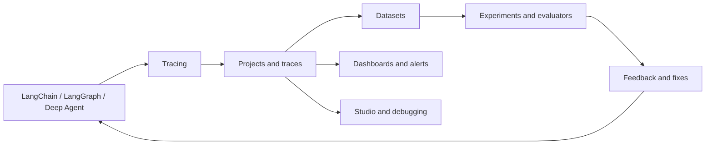
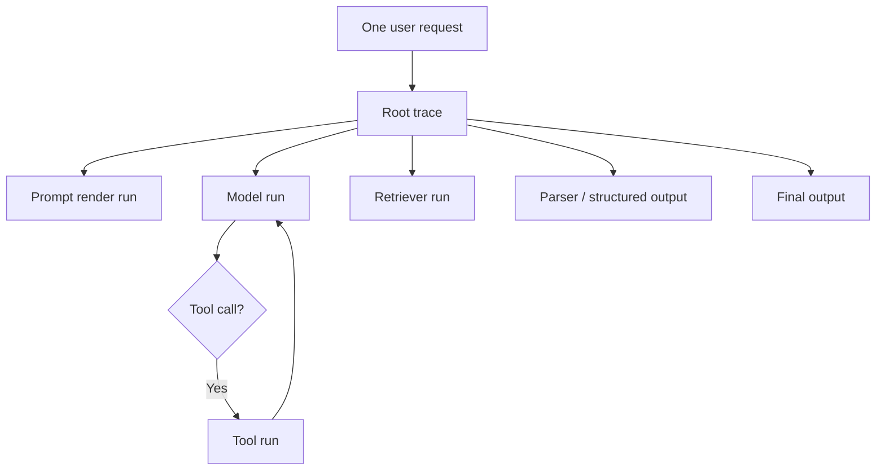
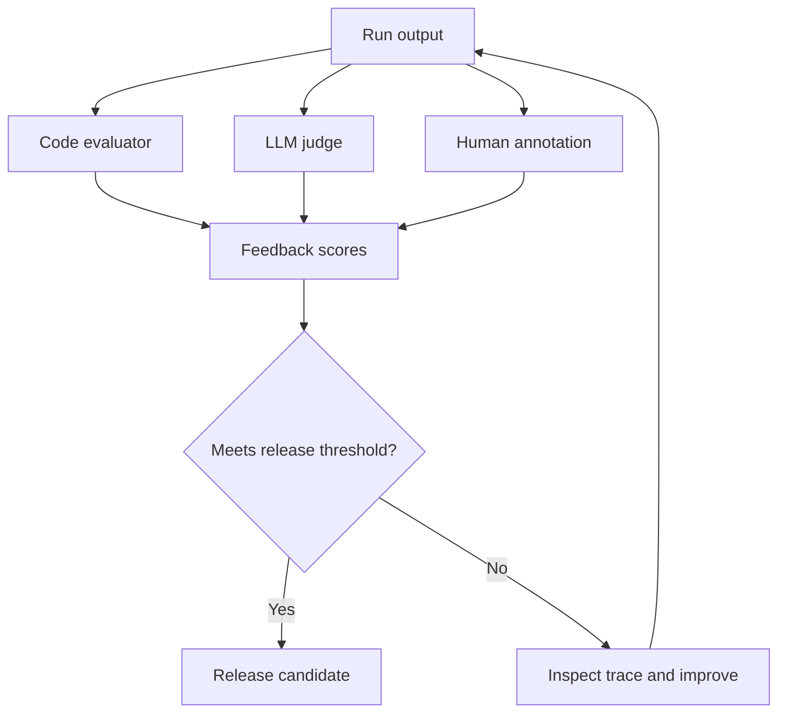
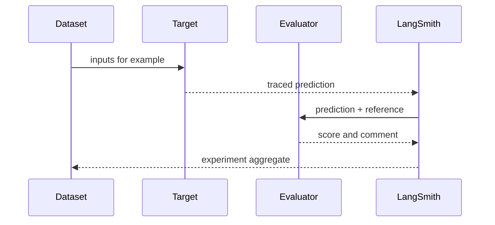
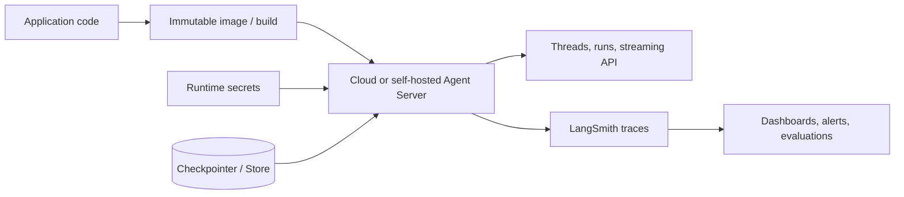

# LangSmith Python Handbook

## Document map (this file's structure)

1. [What LangSmith solves](#1-what-langsmith-solves)
2. [Setup and environment](#2-setup-and-environment)
3. [Data model](#3-data-model)
4. [Automatic tracing](#4-automatic-tracing)
5. [Trace arbitrary Python code](#5-trace-arbitrary-python-code)
6. [Tags, metadata, feedback, and privacy](#6-tags-metadata-feedback-and-privacy)
7. [Datasets](#7-datasets)
8. [Evaluators](#8-evaluators)
9. [Offline experiments](#9-offline-experiments)
10. [Online evaluation and monitoring](#10-online-evaluation-and-monitoring)
11. [Prompts and model configurations](#11-prompts-and-model-configurations)
12. [Studio and deployment](#12-studio-and-deployment)
13. [SDK and CLI surface](#13-sdk-and-cli-surface)
14. [Complete mini-project](#14-complete-mini-project-traced-support-evaluation)
15. [Migration and operating checklist](#15-migration-and-operating-checklist)
16. [Platform architecture and tracing semantics](#16-platform-architecture-and-tracing-semantics)
17. [Python SDK client field guide](#17-python-sdk-client-field-guide)
18. [Trace context and custom instrumentation](#18-trace-context-and-custom-instrumentation)
19. [Trace data and query design](#19-trace-data-and-query-design)
20. [Dataset lifecycle and example management](#20-dataset-lifecycle-and-example-management)
21. [Evaluator design and statistical practice](#21-evaluator-design-and-statistical-practice)
22. [Online evaluation, feedback, and annotation workflows](#22-online-evaluation-feedback-and-annotation-workflows)
23. [Prompt versioning and release workflow](#23-prompt-versioning-and-release-workflow)
24. [Privacy, security, and data governance](#24-privacy-security-and-data-governance)
25. [Operations, cost, and troubleshooting](#25-operations-cost-and-troubleshooting)
26. [Course repository topic map](#26-course-repository-topic-map)
27. [API coverage and reference policy](#27-api-coverage-and-reference-policy)

LangSmith is the observability, evaluation, prompt-management, and deployment
platform for LLM applications. It complements LangChain, LangGraph, Deep Agents,
and non-LangChain applications. The [observability concepts](https://docs.langchain.com/langsmith/observability-concepts),
[evaluation concepts](https://docs.langchain.com/langsmith/evaluation-concepts),
and [Python SDK reference](https://reference.langchain.com/python/langsmith/) are
the authoritative sources for current behavior.

This handbook focuses on the Python SDK and generally available platform concepts. Cloud, regional, hybrid, and self-hosted offerings can differ in endpoints, feature availability, retention, permissions, and version requirements; always verify the deployment-specific documentation.

## 1. What LangSmith solves

LLM failures are often plausible rather than exceptional: a wrong tool argument,
weak retrieval, prompt injection, hallucinated citation, or slow retry can all
produce a successful HTTP response. LangSmith records the intermediate work so
you can debug, evaluate, and monitor it.

| Capability | Use |
| --- | --- |
| Tracing | inspect model, tool, retriever, parser, and graph steps |
| Projects | separate development, staging, and production traffic |
| Datasets | store regression examples and references |
| Evaluations | score quality with code, judges, pairwise, or humans |
| Prompts | version and reuse prompts |
| Feedback | capture user and evaluator judgments |
| Studio | inspect and interact with graph applications |
| Deployment | run managed or self-hosted agent services |

LangSmith is not a model provider, vector database, or replacement for unit
tests. See the [platform overview](https://docs.langchain.com/langsmith/overview).



## 2. Setup and environment

Install the SDK and the evaluation helpers used by your project:

```bash
python -m pip install -U langsmith openevals
```

Tracing configuration uses environment variables. Do not place real values in
source or documentation:

```text
LANGSMITH_TRACING=true
LANGSMITH_API_KEY=YOUR_LANGSMITH_API_KEY
LANGSMITH_PROJECT=YOUR_PROJECT_NAME
LANGSMITH_ENDPOINT=https://api.smith.langchain.com
```

See [environment variables](https://docs.langchain.com/langsmith/env-var) and
[create an API key](https://docs.langchain.com/langsmith/create-account-api-key).
Use separate projects and keys for development, staging, and production.

## 3. Data model

| Object | Meaning |
| --- | --- |
| Run | One unit of work, such as a model call or tool execution |
| Trace | A tree of runs for one user request |
| Thread | Related multi-turn traces, usually connected by a thread ID |
| Project | A named container for traces |
| Dataset | Curated input/output examples |
| Example | One dataset test case |
| Experiment | One target evaluated across a dataset |
| Feedback | Score, value, or comment attached to a run |
| Prompt commit | A versioned prompt in the prompt workspace |
| Annotation queue | Human review workflow |

Use tags for filtering and metadata for dimensions such as application version,
tenant, environment, and feature flag. Never use metadata as a substitute for
access control.

## 4. Automatic tracing

LangChain and LangGraph integrations emit child runs when tracing is enabled:

```python
import os

os.environ["LANGSMITH_TRACING"] = "true"
os.environ["LANGSMITH_API_KEY"] = "YOUR_LANGSMITH_API_KEY"
os.environ["LANGSMITH_PROJECT"] = "YOUR_PROJECT_NAME"

from langchain.chat_models import init_chat_model

model = init_chat_model("PROVIDER:MODEL_NAME")
print(model.invoke("Say hello in one sentence.").text)
```

The [LangChain tracing guide](https://docs.langchain.com/langsmith/trace-with-langchain)
and [LangGraph tracing guide](https://docs.langchain.com/langsmith/trace-with-langgraph)
cover integration-specific configuration. OpenAI, Anthropic, and other supported
SDKs can also be traced directly; see the [integration list](https://docs.langchain.com/langsmith/integrations).



## 5. Trace arbitrary Python code

`@traceable` is the most useful SDK decorator for application functions:

```python
from langsmith import traceable

@traceable(
    name="rewrite_query",
    tags=["retrieval"],
    metadata={"component_version": "1"},
)
def rewrite_query(question: str) -> str:
    return question.strip()

@traceable(name="answer_request")
def answer_request(question: str) -> str:
    return f"Answer for: {rewrite_query(question)}"

print(answer_request("  What is RAG?  "))
```

Decorator options include `name`, `run_type`, `tags`, `metadata`, `client`,
`process_inputs`, `process_outputs`, and `reduce_fn` for streaming. Async
functions are supported. Use `process_inputs` and `process_outputs` to redact
personal or secret data before it reaches the service. See [annotate code](https://docs.langchain.com/langsmith/annotate-code).

```mermaid
flowchart LR
    I[Function inputs] --> R[process_inputs]
    R --> T[@traceable run]
    T --> C[Child traced calls]
    C --> O[Function output]
    O --> S[process_outputs]
    S --> L[LangSmith trace]
```

For lower-level control, use the [`trace` context manager](https://docs.langchain.com/langsmith/nest-traces)
or `RunTree`. Prefer decorators and framework callbacks unless you need custom
parent/child relationships.

## 6. Tags, metadata, feedback, and privacy

LangChain run configuration propagates trace context:

```python
result = chain.invoke(
    {"question": "What is retrieval?"},
    config={
        "tags": ["staging", "rag"],
        "metadata": {
            "app_version": "2026.1",
            "thread_id": "THREAD_ID",
        },
    },
)
```

Capture explicit user feedback with the SDK client:

```python
from langsmith import Client

client = Client()
client.create_feedback(
    run_id="RUN_ID",
    key="user_rating",
    score=1.0,
    comment="Helpful answer",
)
```

Apply [redaction](https://docs.langchain.com/langsmith/mask-inputs-outputs),
retention, workspace access controls, and sampling before production traffic is
enabled. Avoid logging credentials, payment data, health data, or raw user
documents unless your governance policy explicitly allows it.

## 7. Datasets

Datasets turn expected behavior into repeatable tests:

```python
from langsmith import Client

client = Client()
dataset = client.create_dataset(
    dataset_name="support-regression-v1",
    description="Curated support questions",
)
client.create_examples(
    inputs=[
        {"question": "What is the refund window?"},
        {"question": "How do I reset my password?"},
    ],
    outputs=[
        {"answer": "Contact support with a receipt."},
        {"answer": "Use the security settings page."},
    ],
    dataset_id=dataset.id,
)
```

Datasets can be created from SDK code, CSV/JSON, traces, or the UI. Store
metadata such as category, expected source, difficulty, and version. Split data
into development, validation, and test sets. See [manage datasets](https://docs.langchain.com/langsmith/manage-datasets).

## 8. Evaluators

### Deterministic evaluator

```python
def has_answer(run, example):
    output = run.outputs or {}
    text = str(output.get("answer", ""))
    return {
        "key": "has_answer",
        "score": float(bool(text.strip())),
        "comment": "Output must contain non-empty answer text.",
    }
```

### LLM-as-judge

```python
from openevals.llm import create_llm_as_judge

judge = create_llm_as_judge(
    prompt=(
        "Score whether the answer is grounded in the context from 0 to 1.\n"
        "Context: {context}\nAnswer: {answer}"
    ),
    feedback_key="groundedness",
    model="PROVIDER:GRADER_MODEL_NAME",
)
```

Evaluators may be reference-based, reference-free, pairwise, or human. Use
deterministic checks for schemas, citations, and exact values; use judges for
groundedness, helpfulness, tone, and safety; spot-check judge results manually.
See [LLM-as-judge](https://docs.langchain.com/langsmith/llm-as-judge),
[evaluation types](https://docs.langchain.com/langsmith/evaluation-types), and
[annotation queues](https://docs.langchain.com/langsmith/annotation-queues).



## 9. Offline experiments

Evaluate the application target against a dataset before changing production:

```python
from langsmith import evaluate

def target(inputs: dict) -> dict:
    answer = "YOUR_APPLICATION_CALL(inputs['question'])"
    return {"answer": answer}

results = evaluate(
    target,
    data="support-regression-v1",
    evaluators=[has_answer, judge],
    experiment_prefix="support-model-candidate",
    max_concurrency=4,
)
print(results)
```

Use `evaluate` for a target function, `aevaluate` for async applications, and
experiment comparison in the UI or SDK. Track quality, latency, token usage,
cost, tool success, citation validity, and safety separately. See [evaluation quickstart](https://docs.langchain.com/langsmith/evaluation-quickstart).



## 10. Online evaluation and monitoring

Online evaluators score sampled production runs or threads without requiring a
gold answer. Monitor error rate, p50/p95 latency, token cost, empty retrieval,
tool failures, refusal rate, groundedness, and negative user feedback. Convert
important failures into dataset examples and fix them through an offline
experiment before deploying a new version.

Useful platform features include trace filters, dashboards, alerts, annotation
queues, evaluator sampling, cost tracking, and [online evaluations](https://docs.langchain.com/langsmith/online-evaluations).

## 11. Prompts and model configurations

Use the prompt workspace to create, commit, label, pull, and compare prompt
versions. Keep prompt changes separate from model changes when possible.

```python
from langsmith import Client

client = Client()
client.push_prompt(
    "support-assistant",
    object="You are a concise support assistant. Context: {context}",
)
prompt = client.pull_prompt("support-assistant")
```

The exact prompt object format depends on whether the prompt is a chat prompt or
text prompt. See [manage prompts](https://docs.langchain.com/langsmith/manage-prompts)
and [prompt commits](https://docs.langchain.com/langsmith/prompt-commit).

## 12. Studio and deployment

LangSmith Studio is an interactive environment for inspecting graph state,
testing inputs, viewing traces, and iterating on agent behavior. See [Studio](https://docs.langchain.com/langsmith/studio)
and [local Studio usage](https://docs.langchain.com/langsmith/use-studio).

Deployment options include managed LangSmith deployment, a standalone agent
server, and self-hosted installations. Production concerns include authentication,
revisions, environment variables, scaling, persistence, secrets, networking,
custom routes, and rollback. See [deployment](https://docs.langchain.com/langsmith/deployment),
[agent server](https://docs.langchain.com/langsmith/agent-server),
[self-hosting](https://docs.langchain.com/langsmith/self-hosted), and
[Kubernetes](https://docs.langchain.com/langsmith/kubernetes).

For Docker and Kubernetes, keep the application image immutable, inject secrets
at runtime, persist checkpointer/store data separately, expose health checks,
and send traces to a dedicated project. Do not treat tracing as a substitute for
application metrics or incident response.



## 13. SDK and CLI surface

Frequently used Python SDK areas include:

| API | Purpose |
| --- | --- |
| `Client` | datasets, examples, prompts, runs, feedback, projects |
| `traceable` | trace arbitrary sync/async functions |
| `trace` | create a parent trace context |
| `RunTree` | low-level nested run construction |
| `evaluate` / `aevaluate` | offline experiments |
| `create_feedback` | attach human or application feedback |
| dataset methods | create, update, clone, and query test cases |
| prompt methods | push, pull, commit, and tag prompts |

The [CLI guide](https://docs.langchain.com/langsmith/cli) covers login, local
development, projects, datasets, and operational commands. Check the current
[API reference](https://reference.langchain.com/python/langsmith/) for signatures
and parameter changes.

## 14. Complete mini-project: traced support evaluation

This project is runnable after configuring credentials and replacing placeholders.
It demonstrates a traced target, a dataset, a deterministic evaluator, and an
offline experiment.

```python
"""evaluate_support.py"""
import os

from langsmith import Client, evaluate, traceable


@traceable(name="support_answer")
def answer_question(question: str) -> dict:
    # Replace with a real LangChain agent or application call.
    return {"answer": f"Demo answer for: {question}"}


def target(inputs: dict) -> dict:
    return answer_question(inputs["question"])


def non_empty_answer(run, example):
    answer = (run.outputs or {}).get("answer", "")
    return {"key": "non_empty_answer", "score": float(bool(answer.strip()))}


def main() -> None:
    required = ["LANGSMITH_API_KEY", "LANGSMITH_PROJECT"]
    missing = [name for name in required if not os.environ.get(name)]
    if missing:
        raise RuntimeError(f"Set these environment variables first: {missing}")

    client = Client()
    dataset = client.create_dataset(
        dataset_name="support-handbook-demo",
        description="Small regression dataset for the handbook project",
    )
    client.create_examples(
        inputs=[{"question": "What is the refund policy?"}],
        outputs=[{"answer": "A human reviews refund requests."}],
        dataset_id=dataset.id,
    )
    results = evaluate(
        target,
        data=dataset.id,
        evaluators=[non_empty_answer],
        experiment_prefix="support-demo",
    )
    print(results)


if __name__ == "__main__":
    main()
```

Replace the demo target with a real agent, add reference-based correctness and
groundedness evaluators, then configure sampling and privacy policies before
using production data.

## 15. Migration and operating checklist

- Add tracing before adding complex agent behavior.
- Version prompts and datasets; do not rely on ad hoc manual tests.
- Keep test and production projects separate.
- Turn production failures into regression examples.
- Compare experiments on slices, not only global averages.
- Redact inputs and outputs before transmission.
- Set evaluator spend and trace retention limits.
- Use least-privilege workspace access and rotate keys.
- Pin SDK versions and review [release stages](https://docs.langchain.com/langsmith/release-stages).

## Further references

- [Observability quickstart](https://docs.langchain.com/langsmith/observability-quickstart)
- [Tracing concepts](https://docs.langchain.com/langsmith/observability-concepts)
- [Evaluation concepts](https://docs.langchain.com/langsmith/evaluation-concepts)
- [Datasets](https://docs.langchain.com/langsmith/manage-datasets)
- [Experiments](https://docs.langchain.com/langsmith/compare-experiment-results)
- [Feedback](https://docs.langchain.com/langsmith/attach-user-feedback)
- [Python SDK](https://docs.langchain.com/langsmith/smith-python-sdk)

## 16. Platform architecture and tracing semantics

### Product boundary

LangSmith contains multiple related surfaces. Treat their responsibilities separately:

| Surface | Main responsibility | Application boundary |
| --- | --- | --- |
| Observability UI and APIs | Ingest and inspect runs/traces, projects, threads, feedback, dashboards, alerts | Telemetry pipeline; not the application’s primary transaction store. |
| Python SDK (`langsmith`) | Instrument code, upload traces, create/query datasets and examples, manage feedback, run evaluations, manage prompts | Used from application, test, or evaluation processes. |
| Evaluations | Offline experiments and online evaluators, including code, judge, pairwise, and human review | Quality measurement; does not replace deterministic application validation. |
| Prompt workspace | Version prompts/serialized runnable manifests, test in playground, promote commits with tags | Prompt artifact lifecycle; protect secrets and version references. |
| LangGraph Studio | Inspect and interact with LangGraph/Agent Server graphs and runs | Development/debugging surface for graph-based apps. |
| Deployment / Agent Server | Serve graph applications with runs, threads, streaming, persistence, and operational APIs | Runtime for applications; distinct from trace ingestion. |
| Self-hosted / hybrid / Cloud platform | Host/control plane and data placement choices | Availability, networking, storage, scaling, and upgrade responsibilities vary. |

LangSmith is not a model provider, vector database, source-of-truth business database, or replacement for conventional metrics, logs, auth, incident response, and deterministic tests. Tracing tells you what a run did; it does not guarantee the run was correct.

### Run, trace, thread, project, and experiment

- **Run**: one instrumented unit of work, commonly a chain, LLM, tool, retriever, evaluator, or custom function.
- **Trace**: a parent/child run tree for one execution/request. A root run identifies the overall application call; children show nested steps.
- **Thread**: related runs across a conversation or multi-turn task, typically grouped by a stable thread ID.
- **Project**: a logical destination/container for traces, with filters, charts, and project-level settings. Agent-based workspaces may additionally represent application/environment entities; follow the product’s current workspace model.
- **Dataset**: versioned examples used to test behavior.
- **Experiment**: executions of a target against dataset examples with predictions and evaluator feedback.
- **Feedback**: a score/value/comment associated with a run or trace; it may come from a user, evaluator, or reviewer.
- **Prompt commit/tag**: immutable prompt version and a movable label that can select a version for a runtime environment.

Use tags for categorical filtering and metadata for structured context such as release, tenant class, model configuration, or feature flag. Neither tags nor metadata implement authorization. Do not put secrets, raw credentials, or unnecessary personal information in them.

### Trace lifecycle

1. Instrumentation creates a run with inputs and run metadata.
2. The function/provider call executes.
3. Child runs inherit trace context when instrumentation supports context propagation.
4. The run is completed with outputs, error status, timing, and optional token/cost feedback.
5. The SDK batches/uploads telemetry, often asynchronously for low latency.
6. The service stores the trace under the selected workspace/project and applies applicable retention/access policies.
7. Operators inspect, annotate, evaluate, query, or alert on that data.

In short-lived/serverless processes, background upload can be cut off at process exit. Configure callback/background behavior for the runtime and flush/await SDK work using the documented mechanism when necessary. Do not disable trace completion blindly: choose a latency/delivery tradeoff appropriate to the service lifecycle.

## 17. Python SDK client field guide

### `Client` construction

`langsmith.Client` is the main Python SDK entry point. It reads environment configuration by default and can also be configured explicitly with API key, API URL, and workspace context. Use region/self-hosted endpoint settings correctly; a US-default endpoint cannot authenticate a key scoped to another region.

```python
from langsmith import Client

client = Client()  # Uses LANGSMITH_* environment configuration
```

Core environment variables include:

| Variable | Purpose |
| --- | --- |
| `LANGSMITH_TRACING` | Enable/disable automatic SDK/framework tracing. |
| `LANGSMITH_API_KEY` | Authentication credential. Supply through a secret manager/environment. |
| `LANGSMITH_PROJECT` | Default trace project where supported. |
| `LANGSMITH_ENDPOINT` | Regional/self-hosted API endpoint where needed. |
| `LANGSMITH_WORKSPACE_ID` | Select a workspace when a key can access multiple workspaces. |

The SDK reference includes many additional tracing, upload, client, and feature-specific controls. Avoid copying environment variable tables from old blog posts; check the current [environment variable reference](https://docs.langchain.com/langsmith/env-var).

### `Client` resource areas

The client exposes resource methods for datasets/examples, runs/traces, projects, feedback, prompts/commits/tags, experiments, evaluators, and other workspace/platform objects. This is a practical map, not an exhaustive method enumeration:

| Task | Common methods / related surface | Notes |
| --- | --- | --- |
| Create/find projects | `create_project`, project listing methods | Project creation may require permission; `upsert=True` semantics are documented per method. |
| Create datasets | `create_dataset`, `list_datasets`, `read_dataset`, `update_dataset`, `delete_dataset` | Use stable names/IDs and explicit descriptions/metadata. |
| Manage examples | `create_example`, `create_examples`, `list_examples`, `read_example`, `update_example(s)`, `delete_example(s)` | Paginate; preserve inputs/references/splits/metadata/source provenance. |
| Attach feedback | `create_feedback`, feedback read/query methods | Link to the correct run and optionally its trace/project for batching and thread linkage. |
| Manage prompts | `push_prompt`, `pull_prompt`, commit/tag operations | Pin immutable commit IDs or controlled tags for release. |
| Run evaluations | `evaluate` method or top-level `evaluate` / `aevaluate` | Creates an experiment and links target/evaluator results to examples. |
| Wait/flush uploads | Client tracing flush/await methods when needed | Use installed-reference APIs and runtime lifecycle guidance. |
| Query traces | Run/trace query methods and v2 resource APIs | Prefer current query API; migration from old endpoints is ongoing. |

The generated [Python SDK reference](https://reference.langchain.com/python/langsmith/) is the source of truth for full signatures, overloads, pagination, retry behavior, and which methods are stable. The REST surface evolves more quickly than this field guide can duplicate.

### Feedback record

Feedback commonly carries a key (metric name), score and/or categorical value, comment, source/author metadata, and run/trace linkage. Use stable key names and define semantics: for example, a binary `policy_compliant` score should not be mixed with a 1–5 satisfaction rating under the same key.

```python
from langsmith import Client

client = Client()
client.create_feedback(
    run_id="RUN_UUID",
    trace_id="TRACE_UUID",  # optional, useful for trace-scoped/background ingestion
    key="user_rating",
    score=1.0,
    comment="Resolved the issue without a follow-up.",
)
```

Feedback can attach to a child run as well as a root trace. Use child-run feedback to separate retrieval, tool, formatting, or generation quality. Store a trace/run ID in the user feedback flow and pair it with the correct project/workspace; do not attempt to identify a run by matching user text.

## 18. Trace context and custom instrumentation

### Framework tracing and SDK wrappers

LangChain and LangGraph integrations emit nested runs when tracing is enabled and callbacks are correctly propagated. For non-LangChain Python code, use `@traceable` around meaningful functions. Provider wrappers such as `langsmith.wrappers.wrap_openai` instrument supported provider calls; other providers have their own wrapper/integration docs.

```python
from langsmith import traceable

@traceable(name="normalize_support_question", run_type="chain", tags=["support"])
def normalize_support_question(question: str) -> str:
    return " ".join(question.split())

@traceable(name="answer_support_question")
def answer_support_question(question: str) -> dict[str, str]:
    normalized = normalize_support_question(question)
    return {"normalized_question": normalized}
```

`@traceable` is appropriate for a function boundary whose inputs/outputs are valuable for debugging/evaluation. Use meaningful `name` and `run_type` values, stable tags, and small structured metadata. Async functions are supported. Decorator parameters and accepted types can evolve; confirm in the [traceable API reference](https://reference.langchain.com/python/langsmith/run_helpers/traceable).

### Input/output processors and redaction

`process_inputs` and `process_outputs` transform the recorded trace payload for a decorated function; they do not change the application’s real return value. Return new values rather than mutating the caller’s objects. Use them to drop or redact data before upload, reduce payload size, and normalize custom formats. Client-level input/output hiding and function-level processors have precedence rules documented by the SDK; test the resulting trace to verify the actual captured fields.

```python
from typing import Any
from langsmith import traceable

def redact_input(inputs: dict[str, Any]) -> dict[str, Any]:
    return {
        "question_length": len(str(inputs.get("question", ""))),
        "account_id": "[REDACTED]",
    }

@traceable(process_inputs=redact_input, process_outputs=lambda _output: {"status": "completed"})
def handle_request(question: str, account_id: str) -> dict[str, str]:
    # The live application still receives the original arguments.
    return {"answer": f"Demo response for {question}", "account_id": account_id}
```

Redaction should happen before data crosses the telemetry boundary. If a secret appears in child model/tool runs, redacting only the root function’s inputs is insufficient. Add per-integration/per-child processing and inspect a test trace before enabling production tracing.

### `tracing_context`, `trace`, and `RunTree`

| API | Behavior | Recommendation |
| --- | --- | --- |
| `tracing_context(...)` | Configures tracing for a lexical scope and propagates settings to child spans; by itself it need not create a root span. | Selectively enable tracing, choose project, tags, metadata, or client where supported. |
| `trace(...)` context manager | Creates an explicit parent run; provide name/type/input and end with outputs/error. | Use when a decorator cannot represent the boundary or inputs need explicit control. |
| `RunTree` | Low-level manual run/child-run construction and posting/patching. | Last resort; manual parent/child context and completion are easy to get wrong. Prefer `@traceable` or framework callbacks. |
| Provider wrapper | Instruments provider API calls and maps model requests/responses to child spans. | Verify provider/client version compatibility and avoid double wrapping that creates duplicate spans. |

The current Python docs recommend `tracing_context` for selective tracing. It can enable tracing in a block even when process-wide tracing is off or disable it for a scoped region as supported by the SDK. Pass a custom `Client` through the documented per-invocation mechanism when routing to a specific workspace/endpoint. Avoid embedding a key directly in code.

### Tags, metadata, project and parent control

Tags are string labels; metadata is key/value structured data. Add them statically with the decorator, per call through the supported `langsmith_extra`/runnable config, or through a tracing context. Trace context is propagated through supported async/thread execution contexts; custom thread pools/process boundaries may need explicit propagation. Avoid reusing one global mutable metadata dictionary across concurrent requests.

Sampling can reduce cost/data volume but may obscure rare failures. Define sampling by policy (for example, sample normal success, keep failures/high-risk routes), verify whether child runs are sampled consistently with roots, and ensure the sampling mechanism does not block required safety/audit data.

## 19. Trace data and query design

### Run schema and run types

A run includes identity and trace relationship, a run type/name, inputs/outputs or error, start/end times, optional tags/metadata, project/session association, feedback, and token/cost metrics when available. Run type changes UI treatment and can influence how retrievers, LLMs, tools, and chains render.

Common run types include `chain`, `llm`, `tool`, `retriever`, `embedding`, and `prompt`; custom instrumentation can use an appropriate supported type. Pick the semantic type rather than naming every span `chain`. A retriever run should return documents with source metadata if you want useful retrieval inspection.

### Trace topology and run naming

One root trace should correspond to a request or logical operation. Name child spans for operations that answer an operational question: `retrieve_policy`, `rank_candidates`, `call_answer_model`, `authorize_refund`, rather than generic names such as `step_1`. Avoid putting volatile identifiers in run names; put safe correlation metadata in a filterable field.

Nested traces let an engineer localize a plausible-but-wrong answer:

1. Did the expected root application handler run?
2. Did retrieval return relevant, authorized sources?
3. Did the model receive the intended prompt and sources?
4. Did the model request the right tool with valid arguments?
5. Did the application execute/deny the action correctly?
6. Did the final response preserve citations and policy?

### Search and query filters

Trace filters support project/time/run/error/tag/metadata and tree-level predicates. Run filters apply to individual runs; trace/tree filters can constrain a root trace based on its children. Use the current [filter traces guide](https://docs.langchain.com/langsmith/filter-traces) and [trace query API](https://reference.langchain.com/python/langsmith/) because field names and query endpoints differ between legacy and v2 APIs.

Large trace-query operations should bound time windows, projects, returned columns, and page sizes. Prefer v2 threads/traces resources for new functionality where documented; older `/runs/query` helpers and session-oriented APIs are subject to ongoing migration/deprecation. Do not infer a business event from a trace filter alone without validating source values and project identity.

### Threads and multi-turn views

Set a consistent, authenticated thread identifier on each turn so the platform can group conversation traces. Choose whether each run stores only the current message or the full current history; platform thread evaluators have rules for assembling/deduplicating histories. Ensure the ID is opaque and does not expose a user’s email or internal account number. Test that thread IDs never cross tenants.

### Metrics and dashboard interpretation

Useful dimensions include request volume, run/error rate, p50/p95 latency, time-to-first-token, token usage, estimated cost, tool success, retriever emptiness, feedback, evaluation scores, and sampling rate. Separate root request metrics from child-operation metrics to avoid double-counting. Aggregate latency/cost across parallel or retried child spans carefully; the sum of child latency is not always wall-clock latency.

## 20. Dataset lifecycle and example management

### Dataset and example schema

A dataset organizes examples. An example typically carries input mapping, optional reference output mapping, metadata, one or more split assignments, source linkage, and version timestamps. Keep input/output keys stable across target, evaluator, and dataset. `reference_outputs` are the expected result used by evaluators; they are not an instruction to the target.

```python
from langsmith import Client

client = Client()
dataset = client.create_dataset(
    dataset_name="support-policy-regression-v1",
    description="Reviewed cases for policy answers and abstention behavior.",
)
client.create_example(
    dataset_id=dataset.id,
    inputs={"question": "What is the refund review process?"},
    outputs={"answer": "A support specialist reviews a submitted refund request."},
    metadata={"category": "refund", "source_version": "policy-2026-09"},
    split="test",
)
```

Examples above use public SDK concepts; exact optional method parameters should be checked in [`Client.create_dataset`](https://reference.langchain.com/python/langsmith/client/Client/create_dataset) and [`Client.create_example`](https://reference.langchain.com/python/langsmith/client/Client/create_example).

### Dataset construction strategies

- Curate high-value cases manually before generating synthetic cases.
- Convert reviewed production failures into new examples with user/PII redaction.
- Import CSV/JSONL only after validating nested input/output shape, encoding, and split labels.
- Create from traces when preserving source-run/trace linkage helps reproduce the failure.
- Generate synthetic edge cases only with human verification and provenance labels.
- Separate train/development, validation, and held-out test examples. Keep duplicates and near-duplicates under control across splits.

### Versioning and splits

Dataset versions preserve the state of examples for historical evaluation comparisons. A later edit to a dataset or split assignment should not silently change the meaning of a completed benchmark; capture dataset version and experiment metadata. Splits such as `train`, `validation`, and `test` are organizational labels, not built-in statistical guarantees. Maintain split membership deliberately and prevent leakage.

### CRUD and source provenance

The SDK offers create/read/list/update/delete operations for datasets and examples, plus clone/version/split functions. Paginate list operations; consider explicit `as_of` snapshots where supported. Use `source_run_id`, `source_trace_id`, or source-thread fields to record origin when importing from production. Keep large binary files in approved storage and use supported attachment APIs rather than serializing arbitrary binary data into JSON fields.

Dataset deletion, example deletion, cloning, and sharing can be irreversible or affect other users. Verify dataset ID/name and environment before destructive operations; use least-privilege permissions and explicit confirmation in automation. Do not hard-code generated UUIDs into examples or migrations.

References: [manage datasets](https://docs.langchain.com/langsmith/manage-datasets), [programmatic dataset management](https://docs.langchain.com/langsmith/manage-datasets-programmatically), [example data format](https://docs.langchain.com/langsmith/example-data-format), and [dataset versions](https://docs.langchain.com/langsmith/manage-datasets#versioning).

## 21. Evaluator design and statistical practice

### Evaluator input and output contracts

An evaluator compares a prediction with context/reference data and returns feedback. Depending on style, a Python evaluator can accept selected fields such as `inputs`, `outputs`, and `reference_outputs`, or accept `Run` and `Example` objects for access to intermediate trace data. Evaluator result mappings typically provide a feedback `key` plus a numeric `score` or categorical `value`, and optional `comment`/explanation. Exact signatures depend on the evaluation entry point and SDK version.

```python
def non_empty_answer(outputs: dict, **_context) -> dict:
    answer = str(outputs.get("answer", "")).strip()
    return {
        "key": "non_empty_answer",
        "score": float(bool(answer)),
        "comment": "The response must include non-whitespace answer text.",
    }
```

Keep feedback keys stable across versions so experiments remain comparable. Record evaluator version/prompt/model as experiment metadata. Catch evaluator errors distinctly from application-target errors; a missing score is not equivalent to a zero score.

### Evaluator families

| Family | Strength | Failure mode / mitigation |
| --- | --- | --- |
| Deterministic code | Exact schemas, constraints, required fields, citations, tool names, numeric tolerances | Can overfit to formatting or miss semantic truth. Unit-test boundary cases. |
| Reference-based LLM judge | Compare a prediction with input and reference for correctness/completeness | Judge bias, prompt sensitivity, model drift, and cost. Calibrate against human labels. |
| Reference-free judge | Score groundedness, helpfulness, safety, or style without one canonical answer | Rubric may reward plausible but unsupported answers; inspect false positives/negatives. |
| Pairwise comparison | Select relative preference between candidates | Position/style bias and stochastic variation; randomize answer order and include tie/abstain policy. |
| Human annotation | High-quality expert signal, rubric refinement, and failure discovery | Time/cost and reviewer disagreement; define rubric and capture reviewer metadata. |
| Trajectory/tool evaluator | Inspect actions, arguments, retrieval, and intermediate steps | Trace shape/model changes can break mappings; test the run/trajectory schema explicitly. |

OpenEvals and AgentEvals are separate open-source packages providing reusable evaluator factories; install them only when used. LangSmith stores and orchestrates evaluation results, but the external package provides some evaluator implementations.

### Offline `evaluate` / `aevaluate`

The target receives each example’s inputs and returns predicted outputs. `data` can be a dataset name/ID or an iterator of examples. `evaluators` score each prediction. Options commonly include experiment prefix/description, concurrency, metadata, client, and upload behavior; exact arguments are documented in the [evaluation reference](https://reference.langchain.com/python/langsmith/evaluation/).

```python
from langsmith import evaluate

def target(inputs: dict) -> dict:
    return {"answer": "A specialist reviews the submitted request."}

results = evaluate(
    target,
    data="support-policy-regression-v1",
    evaluators=[non_empty_answer],
    experiment_prefix="support-agent-candidate",
    max_concurrency=4,
    metadata={"app_version": "2026.10", "models": ["PROVIDER:MODEL"]},
)
```

Use `aevaluate` for async targets/evaluators and async execution contexts. Match target input keys to the dataset schema. If target output is a bare string, confirm the evaluation mapping convention rather than assuming it becomes `outputs["answer"]`. A target error, evaluator error, and evaluator score are separate outcomes.

### Experiment design

- Freeze a candidate (code commit, model, prompt commit, tool definitions, index version, dependency lock) before measuring.
- Run baseline and candidate against the same dataset version and evaluator versions.
- Compare overall metrics and important slices (intent, language, user segment, source freshness, risk level).
- Include repetitions for nondeterministic targets/judges when variance matters; record randomization and model temperatures.
- Use a held-out test set for release decisions; use development data for iteration.
- Set `max_concurrency` deliberately, monitor provider quotas, and budget both target and judge calls.
- Inspect individual regressions and traces; aggregate mean scores can hide high-severity failures.
- Define release thresholds, failure severity, minimum sample sizes, and rollback policy before a CI gate.

Statistical scores are estimates, not a proof of behavior. A one-point average increase on a small or unrepresentative dataset is not reliable evidence of a production improvement.

### Evaluator calibration

Compare LLM judge scores to human labels on a representative sample. Review disagreement by category, not just aggregate correlation. Refine rubric definitions and examples; measure inter-reviewer agreement when multiple human reviewers participate. Keep judge changes separate from target changes where possible so their effects can be understood.

References: [evaluation concepts](https://docs.langchain.com/langsmith/evaluation-concepts), [evaluation workflow](https://docs.langchain.com/langsmith/evaluation), [LLM-as-judge](https://docs.langchain.com/langsmith/llm-as-judge), [pairwise evaluation](https://docs.langchain.com/langsmith/evaluate-pairwise), and [experiment configuration](https://docs.langchain.com/langsmith/experiment-configuration).

## 22. Online evaluation, feedback, and annotation workflows

### Online evaluation lifecycle

Online evaluation attaches evaluators to production runs, threads, or trajectories. Rules can select evaluator type, project/agent/environment, filters, and sampling rate. Run-level evaluation can inspect a single trace; thread evaluation runs after a conversation is considered complete; trajectory evaluators inspect action paths. This is distinct from offline `evaluate(...)`, which runs a target over a dataset experiment.

Online evaluation needs a spend/retention plan. Sampling reduces evaluator calls, while filters can focus on risky routes, errors, negative feedback, or selected metadata. Some evaluated runs may receive retention upgrades depending on product configuration and plan; understand billing/retention before enabling automatic evaluators at scale.

Use online evaluation for continuous monitoring signals such as malformed output, missing citations, tool failures, policy violations, or sampled groundedness. Do not make an expensive or nondeterministic judge the only real-time authorization gate for a critical operation.

### Application feedback loop

1. Attach a run ID and project/thread context to the user-facing response/session.
2. Capture explicit, consented feedback (thumbs, category, comment) via an application endpoint.
3. Validate allowed feedback keys/values and bind feedback to the authenticated user/session.
4. Call `create_feedback` asynchronously or using the documented background behavior; avoid adding unnecessary latency to the response path.
5. Filter trace project dashboards by feedback and category.
6. Review the underlying trace, redact if necessary, and add a verified failure to a regression dataset.
7. Fix, run offline evaluation, compare candidate, and ship only after checks pass.

Use stable feedback keys (`helpful`, `correctness`, `policy_compliant`) and unambiguous scales. A user star rating measures perceived usefulness, not factual correctness.

### Annotation queues

Annotation queues organize run or thread reviews around a rubric and reviewer workflow. They can support single-run review, pairwise comparisons, reviewer assignment/reservation, required fields, comments, and export into datasets where supported. Queue setup, permissions, and the exact Python SDK methods are version/product dependent; use the [annotation queue guide](https://docs.langchain.com/langsmith/annotation-queues) and [SDK management guide](https://docs.langchain.com/langsmith/annotation-queues-sdk).

Rubric design should define the score scale, observable evidence, edge cases, and what to do when reviewers lack context. Hide model/variant identifiers for pairwise review when possible to reduce bias. Convert annotations to data only with access/retention permissions and provenance preserved.

### Online monitor to offline regression

Production failures become more useful when promoted into a reproducible test case: capture redacted input, reference or assertion, relevant metadata, and source trace/thread ID; then add it to a dataset split reserved for regression or adversarial cases. Avoid adding every noisy run to a benchmark—prioritize severity, distinct root cause, and representative coverage.

## 23. Prompt versioning and release workflow

### Prompt push/pull

The Python client’s `push_prompt(name, object=...)` creates or updates a prompt artifact/commit; `pull_prompt(name_or_reference)` retrieves a serialized prompt. A reference can include a commit hash or tag. Prompt objects may be chat templates, text templates, or serialized runnables when supported.

```python
from langsmith import Client
from langchain_core.prompts import ChatPromptTemplate

client = Client()
prompt = ChatPromptTemplate.from_messages([
    ("system", "Answer from supplied policy context. If evidence is absent, say so."),
    ("human", "Question: {question}\nContext: {context}"),
])
client.push_prompt("support-policy-answer", object=prompt)

# In a deployment, pin a reviewed immutable commit or a controlled promotion tag.
deployed_prompt = client.pull_prompt("support-policy-answer:production")
```

Prefer immutable commit pins for reproducible releases. Tags are movable pointers and are useful for environment promotion (`staging`, `production`) when a deliberate release process controls tag updates. Record the resolved prompt commit in trace/experiment metadata so a historical result can be reproduced.

### Prompt change control

1. Make a prompt change and save a new commit; do not overwrite historical comparison context.
2. Inspect rendered messages and run prompt-specific adversarial/format tests.
3. Compare candidate prompt commit with baseline on the same dataset/model/tool/index versions.
4. Review score slices and traces, not only average judge scores.
5. Promote a commit tag or update the application’s pinned commit reference through change control.
6. Monitor production traces and keep rollback to the previous prompt version available.

Do not store API credentials or personal information in prompt templates. Serialized model/runnable manifests may include configuration; keep secrets as environment/secret references and inspect artifacts before sharing.

See [programmatic prompt management](https://docs.langchain.com/langsmith/manage-prompts-programmatically), [prompt commits and tags](https://docs.langchain.com/langsmith/manage-prompts), and [prompt versioning concepts](https://docs.langchain.com/langsmith/prompt-engineering-concepts).

## 24. Privacy, security, and data governance

### Trace data is data egress

Tracing can capture user inputs, prompts, model responses, tool arguments/results, retrieved documents, exceptions, and metadata. Treat enabling tracing as a data-sharing decision. Decide the allowed data class, workspace, region/endpoint, sampling, redaction, retention, access, and deletion policy before production rollout.

Controls include:

- Minimize what is instrumented; do not trace entire request/session objects by default.
- Redact or transform at the SDK/integration boundary before uploading.
- Ensure child runs and provider wrappers do not reintroduce data removed from the root span.
- Use regional endpoints and an approved deployment mode for residency requirements.
- Separate dev/staging/prod projects/tags with workspace least privilege.
- Avoid putting PII or secrets in run names, tags, metadata, evaluator comments, prompt commits, or exception strings.
- Apply retention and deletion rules to traces, datasets, artifacts, embeddings, and backups as separate stores.
- Restrict sharing/public dataset features and export permissions.
- Use TLS, rotate API keys, and never expose server-side LangSmith credentials in a browser.

### Redaction test procedure

1. Create a synthetic payload containing recognizable fake secrets and personal-data patterns.
2. Run it through root and nested child instrumentation.
3. Inspect the actual LangSmith trace, including error fields, metadata, tool inputs, and model outputs.
4. Assert the sensitive markers are absent from every recorded field.
5. Verify that application functionality still receives the original necessary values and that trace redaction did not mutate shared objects.
6. Repeat after SDK/provider upgrades and middleware changes.

### Service keys and permissions

Use workspace/organization roles and scoped service credentials appropriate to the operation. Dataset read, write, export/download, prompt update, evaluator, and trace access may be distinct permissions. Do not assume that a successful UI action implies an API key can perform it, or that trace metadata limits access. Audit and rotate keys, restrict CI service keys, and keep them out of client-side code.

### Retention is configurable and product-specific

Retention periods, extended retention behavior, and billing are plan/deployment/version-dependent and change over time. Do not hard-code a duration from an old example; consult current usage/billing and self-hosted policy documentation. Self-hosted operators own backup, deletion, storage, security patches, and disaster recovery for their deployment.

References: [mask inputs and outputs](https://docs.langchain.com/langsmith/mask-inputs-outputs), [LangSmith environment variables](https://docs.langchain.com/langsmith/env-var), [workspace permissions](https://docs.langchain.com/langsmith/organization-workspace-operations), [data retention and billing](https://docs.langchain.com/langsmith/usage-and-billing), and [self-hosting](https://docs.langchain.com/langsmith/self-hosted).

## 25. Operations, cost, and troubleshooting

### Operational checks

| Symptom | Inspect |
| --- | --- |
| No traces appear | `LANGSMITH_TRACING`, valid API key/endpoint/workspace, process lifecycle, callback propagation, project selection, sampling, and network egress. |
| Only root or only child spans appear | Provider/framework wrapper, async/context propagation, duplicated clients, callback config propagation, background upload completion. |
| Trace appears in wrong project | `LANGSMITH_PROJECT`, tracing context overrides, project names/IDs, workspace selection, deployment environment variables. |
| Inputs/outputs differ from expected | `process_inputs`/`process_outputs`, client-level hide processors, serializer, provider wrappers, message content blocks. |
| Duplicate traces | Multiple wrappers/decorators, nested framework callbacks plus manual `RunTree`, retried request generating a new root run ID. |
| Evaluation lacks scores | Evaluator signature/schema, missing example reference fields, evaluator exceptions, feedback key config, experiment trace upload, async completion. |
| Online evaluator cost rises | Sampling rate, selected projects/filters, evaluator model, thread idle behavior, traffic changes, retries, run retention upgrades. |
| API returns 401/403 | Correct regional endpoint/workspace ID, key scope/expiration, workspace permissions, resource-specific permissions. |

### Cost controls

- Sample ordinary traffic, while preserving failures/high-risk cases where policy permits.
- Track model and evaluator usage separately; a judge can cost as much as another model call for every example.
- Bound `max_concurrency`; avoid overloading provider quotas or SDK upload queues.
- Keep trace payloads small; large prompts/documents increase transfer and storage cost.
- Use code evaluators for exact/simple checks and reserve LLM judges for semantics.
- Configure retention/sampling based on investigation needs, not blanket full fidelity without a data plan.
- Compare evaluation repetitions and models against the decision’s value; do not spend on an evaluator with no action threshold.

### CLI and API evolution

The LangSmith CLI supports login/configuration and resource families for projects, datasets/examples, prompts, evaluators, and deployment tasks, with command names and flags changing by release. Use `langsmith --help` and the current [CLI reference](https://docs.langchain.com/langsmith/cli); treat a copied shell command as release-specific. The public API/SDK is also evolving toward newer trace/thread/run query resources. Prefer generated current SDK methods over calling undocumented endpoints directly.

## 26. Course repository topic map

The repository was inspected at commit [`9933fe7`](https://github.com/pdichone/production-course-main-code/tree/9933fe78aba0cba40812856d9baeb0640cad70ca). The relevant Python examples and their contributions are:

| Course file(s) | Topics represented | Handbook sections |
| --- | --- | --- |
| [`langsmith_setup.py`](https://github.com/pdichone/production-course-main-code/blob/9933fe78aba0cba40812856d9baeb0640cad70ca/langsmith_setup.py) | Environment setup, `@traceable`, custom names/tags, metadata, wrapped LangChain/OpenAI calls | 2, 4–6, 18 |
| [`monitoring.py`](https://github.com/pdichone/production-course-main-code/blob/9933fe78aba0cba40812856d9baeb0640cad70ca/monitoring.py) | Structured JSON logging, metrics collection, latency/token estimates, instrumented model wrapper, trace decorator | 16, 18, 19, 25 |
| [`testing_patterns.py`](https://github.com/pdichone/production-course-main-code/blob/9933fe78aba0cba40812856d9baeb0640cad70ca/testing_patterns.py) | Mock/integration testing, dataset creation, custom evaluator functions, experiments, comparison/regression loop | 7–9, 21, 27 |
| [`security_patterns.py`](https://github.com/pdichone/production-course-main-code/blob/9933fe78aba0cba40812856d9baeb0640cad70ca/security_patterns.py) | Sanitization/PII/validation concepts whose trace payloads require privacy controls | 6, 24 |
| [`cost_optimization.py`](https://github.com/pdichone/production-course-main-code/blob/9933fe78aba0cba40812856d9baeb0640cad70ca/cost_optimization.py) | Model routing, semantic caching, token-budget concepts and telemetry dimensions | 19, 21, 25 |
| [`smart_bot_section1.py`](https://github.com/pdichone/production-course-main-code/blob/9933fe78aba0cba40812856d9baeb0640cad70ca/smart_bot_section1.py) | Agent integration with LangSmith configuration, structured response, errors, and batching | 4, 14; see LangChain handbook |
| [`pyproject.toml`](https://github.com/pdichone/production-course-main-code/blob/9933fe78aba0cba40812856d9baeb0640cad70ca/pyproject.toml) | Course package versions including `langchain>=1.2.7`, `langchain-core>=1.2.7`, and `langgraph>=1.0.7` | 2, 17, 27 |

The sample `monitoring.py` estimates token counts from word counts and implements custom in-memory metrics. These are useful demonstrations of instrumentation concepts, but word-based token guesses are not provider-authoritative usage and the in-process collector is not a distributed metrics backend. The sample `testing_patterns.py` includes hand-built evaluation frameworks; use current LangSmith `evaluate`/`aevaluate` and current pytest integrations for supported workflows.

The course tree has no visible `LICENSE` file. Its snippets are used as topic references and source-linked examples are newly written/adapted rather than substantially reproduced verbatim.

## 27. API coverage and reference policy

This handbook documents the Python-focused LangSmith workflows most application teams need: environment/configuration, automatic and custom tracing, `Client`, `traceable`, `tracing_context`, `trace`, `RunTree`, wrappers, datasets/examples, feedback, evaluation, prompts, CLI, and platform workflow concepts.

It does **not** reproduce the entire LangSmith product REST API, every administrative/billing/workspace method on `Client`, every product-specific UI feature, or the SDKs in Java/Go/TypeScript. Those surfaces are extensive and versioned separately. For each documented method, the linked SDK reference is authoritative for parameters, return schemas, pagination, errors, and deprecation state. For REST resource and authentication details, consult the current LangSmith [REST API reference](https://docs.langchain.com/langsmith/smith-api-ref) and [Python SDK reference](https://reference.langchain.com/python/langsmith/).

When upgrading, verify package release notes, test trace shape/redaction, rerun evaluation datasets, confirm permissions and endpoint/region, and inspect the current changelog. Do not build new integrations on undocumented APIs or assume that product availability is uniform between Cloud and self-hosted deployments.
